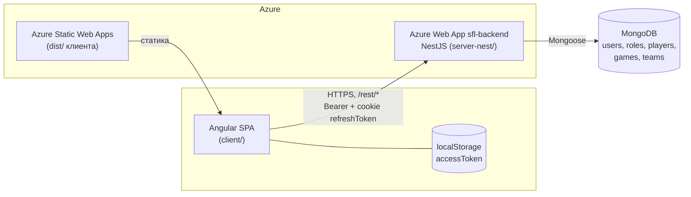
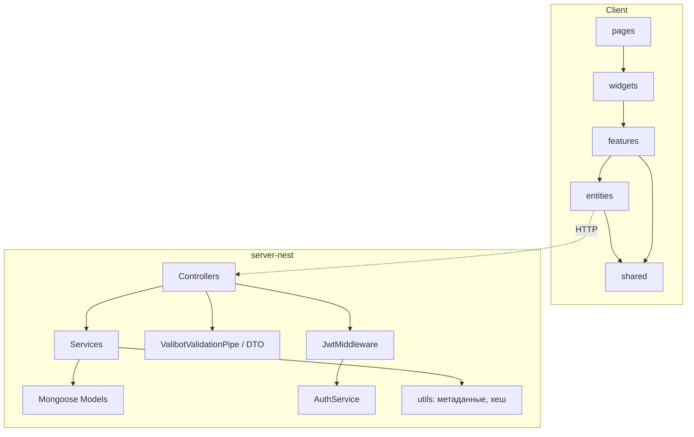
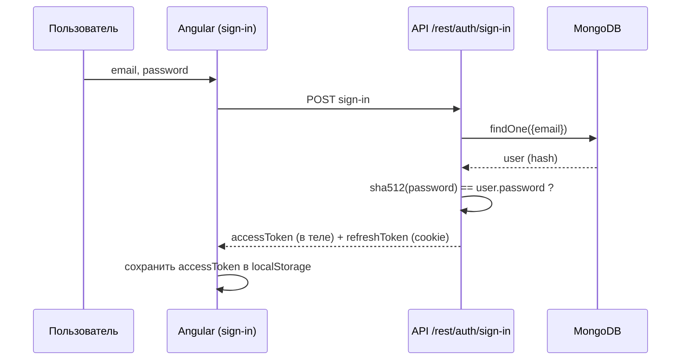
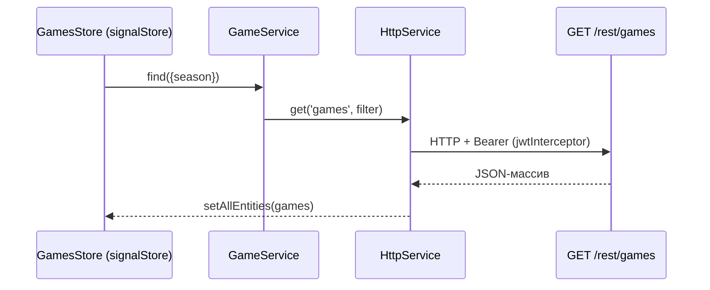

# Архитектурный блюпринт проекта SFL

> Документ описывает архитектуру по фактическому коду репозитория (состояние на 2026-10-25).
> Где выводы сделаны по косвенным признакам, это отмечено явно.
> Раздел 12 содержит найденные проблемы, которые нужно исправить до расширения функциональности.

**Written for:** разработчики команды SFL, включая тех, кто подключается к проекту впервые.

---

## 1. Обзор и технологический стек

SFL (Saturday Football League) — веб-приложение для учёта матчей, игроков, команд, капитанов и рейтинговой статистики любительской футбольной лиги.

| Слой | Технологии | Где лежит |
|---|---|---|
| Клиент (SPA) | Angular 18.2, Angular Material, NgRx Signals/Store, Highcharts, date-fns, lodash-es | [client/](client/) |
| API (основной) | NestJS 10, Mongoose 8, valibot 0.29, envalid, winston, @nestjs/jwt, @nestjs/swagger | [server-nest/](server-nest/) |
| API (legacy) | Express 4, Mongoose 8, valibot, jsonwebtoken | [server/](server/) |
| База данных | MongoDB (строка подключения из `DATABASE_URL`, имя БД из `DATABASE_DB`) | — |
| Тесты | Vitest (сервер), Karma/Jasmine (клиент), Jest (legacy-сервер) | — |
| Линт/формат | ESLint, Prettier (во всех трёх пакетах) | — |
| Хостинг | Azure Static Web Apps (клиент), Azure Web App `sfl-backend` (API) | [.github/workflows/](.github/workflows/) |
| Пакетный менеджер | pnpm | `pnpm-lock.yaml` в каждом пакете |

**Тип проекта:** монорепозиторий без общего workspace. Три независимых npm-проекта в одной git-ветке `main`.

**Статус частей:**
- `server-nest/` — **действующий** бэкенд. Единственный, который деплоится в CI.
- `server/` — **legacy**. Предыдущая реализация на Express. В CI не участвует. Большая часть маршрутов заглушки (см. [server/src/app/routes/games.router.ts](server/src/app/routes/games.router.ts)). Статус перед удалением нужно уточнить у команды.
- `client/` — **действующий** фронтенд.
- `_backups/` — JSON-выгрузки тестовых коллекций (`users`, `roles`, `teams`, `players`).

---

## 2. Архитектурный паттерн

### 2.1. Общая схема

Клиент-серверное приложение: SPA на Angular обращается к REST API на NestJS, API работает с MongoDB.



### 2.2. Внутренний паттерн клиента

Клиент организован по слоям, похожим на Feature-Sliced Design. Алиасы путей: `@entities/*`, `@shared/*`, `@features/*`, `@widgets/*`.

| Слой | Назначение | Примеры |
|---|---|---|
| `pages/` | Страницы верхнего уровня | `home`, `sign-in-page`, `captains-page` |
| `widgets/` | Крупные составные блоки | `players-admin-widget`, `captains-admin-widget` |
| `features/` | Пользовательские сценарии | `games-table`, `players-toggle`, `captains-selection` |
| `entities/` | Доменные модули: API, store, компоненты, типы | `games`, `players`, `captains`, `teams`, `charts` |
| `shared/` | Инфраструктура и переиспользуемое | `services/http.service.ts`, `interceptors/jwt.interceptor.ts`, `ui/` |

В `entities/<name>/` обычно есть `routes.ts`, `services/`, `store/`, `components/`, `pages/`, `types.ts`, `index.ts` (публичный API модуля).

### 2.3. Внутренний паттерн сервера (NestJS)

Модульная структура по доменным сущностям. Каждый модуль содержит контроллер, сервис, схему Mongoose, DTO (валидация valibot).

```
server-nest/src/
├── main.ts                 # bootstrap: prefix /rest, Swagger, CORS, HTTP/HTTPS
├── app.module.ts           # корневой модуль, подключение middleware
├── config/configuration.ts # envalid: валидация переменных окружения
├── constants.ts, enums.ts
├── entities/               # доменные модули
│   ├── auth/       (sign-in, sign-out, whoami)
│   ├── users/      (тестовые пользователи)
│   ├── roles/
│   ├── players/    (CRUD, капитаны, пересчёт статистики)
│   ├── games/      (CRUD матчей)
│   ├── teams/
│   ├── charts/     (агрегации для графиков)
│   └── migrations/ (разовые миграции данных)
└── shared/
    ├── interceptors/context/   # глобальный ContextInterceptor
    ├── middlewares/user/       # JwtMiddleware
    ├── pipes/custom-pipe/      # ValibotValidationPipe
    ├── services/logger.service.ts  # winston с ротацией файлов
    └── utils/string.ts         # hash() (SHA-512)
```

Сервисы работают с моделями Mongoose напрямую, отдельного слоя репозиториев нет. Вычисляемые метаданные игроков и матчей (рейтинговая система, очки, MVP) считаются в утилитах [server-nest/src/entities/players/utils/](server-nest/src/entities/players/utils/) и сохраняются в документах.

---

## 3. Компоненты и их ответственность

### 3.1. Клиент

- **Маршрутизация** — [client/src/app/app.routes.ts](client/src/app/app.routes.ts). Корневые маршруты: `''`, `home`, `sign-in`. Далее подключаются `PLAYERS_ROUTES` и `GAMES_ROUTES` из модулей `entities`. Ленивая загрузка через `loadComponent`.
- **HTTP** — [client/src/shared/services/http.service.ts](client/src/shared/services/http.service.ts). Обёртка над `HttpClient`, базовый URL берётся из `environment.API_KEY` (строка `https://sfl.com:3001/rest`; имя поля вводит в заблуждение, это URL, а не ключ).
- **Авторизация на клиенте** — [client/src/shared/interceptors/jwt.interceptor.ts](client/src/shared/interceptors/jwt.interceptor.ts). Берёт `accessToken` из `localStorage`, добавляет заголовок `Authorization: Bearer ...` и включает `withCredentials: true` (нужно для cookie `refreshToken`).
- **Состояние** — два подхода одновременно:
  - `@ngrx/signals` `signalStore` с `withEntities`: [client/src/entities/games/store/games.store.ts](client/src/entities/games/store/games.store.ts), а также `players.feature.ts`, `teams.feature.ts`, `statistics.feature.ts`, `new-game.store.ts`.
  - `@ngrx/store` подключён в [client/src/app/app.config.ts](client/src/app/app.config.ts) через `provideStore()` без редьюсеров. Фактически используется в основном для devtools.
- **Графики** — Highcharts через `highcharts-angular`, сервис [client/src/entities/charts/charts.service.ts](client/src/entities/charts/charts.service.ts).

### 3.2. API (server-nest)

- **Глобальный префикс**: `/rest`. Swagger UI доступен по `/rest`.
- **CORS**: разрешён только `CLIENT_HOSTNAME` и `CLIENT_HOSTNAME:CLIENT_PORT`, `credentials: true`.
- **Конфигурация**: [server-nest/src/config/configuration.ts](server-nest/src/config/configuration.ts). Обязательные переменные: `STAGE`, `DATABASE_URL`, `DATABASE_DB`, `CLIENT_HOSTNAME`, `CLIENT_PORT`, `ACCESS_TOKEN_SECRET`, `REFRESH_TOKEN_SECRET`. `PORT` по умолчанию 3001.
- **Логирование**: [server-nest/src/shared/services/logger.service.ts](server-nest/src/shared/services/logger.service.ts), winston с ежедневной ротацией. Подключён через `FileLoggerService`.

### 3.3. Эндпоинты API

| Модуль | Метод и путь | Защищён JwtMiddleware |
|---|---|---|
| auth | `GET /rest/auth/whoami`, `POST /rest/auth/sign-in`, `POST /rest/auth/sign-out` | Да (кроме sign-in и sign-out) |
| users | `GET /rest/users`, `POST /rest/users/test-users` | Да |
| migrations | `GET /rest/migrations/convert-players-user-to-uuid` | Да |
| players | `GET /players`, `GET /players/:id`, `GET /players/captains`, `POST`, `PATCH /:id`, `DELETE /:id`, `GET /players/recalculate/season` | **Нет** |
| games | `GET /games`, `GET /games/:id`, `POST`, `PATCH /:id`, `PUT /:id`, `DELETE /:id` | **Нет** |
| teams | `GET`, `POST`, `PUT /:id` | **Нет** |
| roles | `POST` | **Нет** |
| charts | `GET /charts/top-total-points-players`, `GET /charts/top-ancient-rating-system-players` | **Нет** |

Точная картина защиты описана в разделе 12.

---

## 4. Слои и зависимости



**Правила зависимостей на клиенте** (соблюдаются по структуре папок, автоматической проверки не найдено):
- `pages` → `widgets` → `features` → `entities` → `shared`.
- `shared` не импортирует из `entities`, `features`, `widgets`, `pages`.

**Правила на сервере:**
- Модуль `GamesModule` импортирует `PlayersModule` через `forwardRef`. Это циклическая зависимость между `games` и `players`. Её нужно учитывать при рефакторинге.
- `PlayersService` дублируется в провайдерах `GamesModule` (см. [server-nest/src/entities/games/games.module.ts](server-nest/src/entities/games/games.module.ts)). Это может создавать второй экземпляр сервиса.

---

## 5. Модель данных

Коллекции MongoDB (по схемам Mongoose):

| Коллекция | Файл схемы | Заметки |
|---|---|---|
| `users` | [users.schema.ts](server-nest/src/entities/users/users.schema.ts) | Поле `password` — хеш SHA-512 без соли. Скрывается в `toJSON` |
| `roles` | [roles.schema.ts](server-nest/src/entities/roles/roles.schema.ts) | Модель есть, RBAC не применяется (см. TODO в [README.md](README.md)) |
| `players` | [players.schema.ts](server-nest/src/entities/players/players.schema.ts) | Ссылка на `user`, сезонная и карьерная статистика, рейтинговые поля |
| `games` | [game.schema.ts](server-nest/src/entities/games/game.schema.ts) | Участники (`IPlayerStatistic`), метаданные матча (`IGameMetadata`), ошибки расчёта |
| `teams` | [team.schema.ts](server-nest/src/entities/teams/team.schema.ts) | Команды матча |

**Ключевые связи:**
- `player.user` → `users._id` (миграция `convert-players-user-to-uuid` переводит ссылки на UUID).
- `game.players[]` → `players._id` через `IPlayerStatistic.playerId` и `teamId` → `teams`.

**Вычисляемые данные:**
- Метаданные игрока за сезон и карьеру: [player-season-metadata.ts](server-nest/src/entities/players/utils/player-season-metadata.ts), [player-career-metadata.ts](server-nest/src/entities/players/utils/player-career-metadata.ts), [player-common-metadata.ts](server-nest/src/entities/players/utils/player-common-metadata.ts).
- Метаданные матча: `IGameMetadata` и `IPlayerGameResultMetadata` в `game.schema.ts`.
- Рейтинговая система (`ancientRatingSystem`: `plusMinus`, `lastResult`, `totalPoints`) считается в `players` и используется в `charts`.
- Пересчёт запускается вручную через `GET /players/recalculate/season`. Это не фоновая задача.

**Агрегации** для графиков: [charts.service.ts](server-nest/src/entities/charts/charts.service.ts), используется `aggregate` с `$unset` для скрытия `user.password` и `user.roles`.

---

## 6. Сквозные задачи (cross-cutting concerns)

### 6.1. Аутентификация и авторизация

- **Токены**: access и refresh, подписываются HS512 ([main](server-nest/src/app.module.ts) регистрирует `JwtModule` глобально). Секреты берутся из `ACCESS_TOKEN_SECRET` и `REFRESH_TOKEN_SECRET`.
- **Вход**: `POST /rest/auth/sign-in` возвращает пару токенов ([auth.service.ts](server-nest/src/entities/auth/auth.service.ts)).
- **Обновление**: `JwtMiddleware` ([jwt.middleware.ts](server-nest/src/shared/middlewares/user/jwt.middleware.ts)) при протухшем access-токене проверяет refresh-токен из cookie и выдаёт новый access-токен.
- **Выход**: `POST /rest/auth/sign-out`.
- **Роли (RBAC)**: не реализованы. Роли хранятся в модели, но ни один контроллер ими не пользуется. В TODO проекта это отмечено как задача.

### 6.2. Валидация

- Единый механизм: `ValibotValidationPipe` ([valibot-validation.pipe.ts](server-nest/src/shared/pipes/custom-pipe/valibot-validation.pipe.ts)) + схемы в `*.dto.ts`.
- **Известная проблема**: при ошибке валидации pipe возвращает объект ошибки вместо того, чтобы её выбросить. См. раздел 12.

### 6.3. Обработка ошибок

- Контроллеры возвращают результат через `@Res() res` и `res.json(...)`. Это обходит стандартную сериализацию Nest и глобальные фильтры исключений.
- В сервисах используется `try/catch` с конвертацией в `HttpException` (пример: `auth.service.ts`).
- Ошибки расчёта матча накапливаются в поле `errors` метаданных игрока.

### 6.4. Логирование и мониторинг

- `FileLoggerService` (winston) с ротацией. Используется в контроллерах и сервисах.
- Остались отладочные `console.log`, в том числе с паролем (см. раздел 12). Всего в `server-nest/src` около 10 вызовов `console.log`.

### 6.5. Конфигурация и секреты

- Переменные окружения валидируются через `envalid` при старте.
- Секреты не должны попадать в репозиторий. В `git ls-files` `.env`, `ssl/`, `*.pem`, `*.key` не найдены.
- Однако в коде есть захардкоженная passphrase для локального SSL в [main.ts](server-nest/src/main.ts). См. раздел 12.

### 6.6. Тестирование

- **Сервер**: Vitest. Есть unit-тесты только для утилит метаданных игроков ([player-career-metadata.test.ts](server-nest/src/entities/players/utils/player-career-metadata.test.ts), [player-common-metadata.test.ts](server-nest/src/entities/players/utils/player-common-metadata.test.ts)). Есть e2e-шаблон [server-nest/test/app.e2e-spec.ts](server-nest/test/app.e2e-spec.ts), в котором не проверено реальное поведение.
- **Клиент**: Karma/Jasmine. Около восьми spec-файлов (sign-in, JWT-интерцептор, пайп, часть компонентов players).
- Покрытие контроллеров и сервисов API практически отсутствует.

---

## 7. Потоки данных (примеры)

### 7.1. Вход пользователя



### 7.2. Загрузка списка матчей



### 7.3. Пересчёт статистики сезона

Запускается вручную: `GET /rest/players/recalculate/season?seasonId=...&playerIds=...`. Сервис обходит игроков через `forEach(async ...)` без ожидания промисов (см. раздел 12).

---

## 8. Деплой и окружения

| Артефакт | Пайплайн | Триггер | Куда |
|---|---|---|---|
| API (`server-nest/`) | [main_sfl-backend.yml](.github/workflows/main_sfl-backend.yml) | push в `main` с изменениями в `server-nest/**` | Azure Web App `sfl-backend` |
| Клиент (`client/`) | [azure-static-web-apps-white-pond-05131751e.yml](.github/workflows/azure-static-web-apps-white-pond-05131751e.yml) | push / PR | Azure Static Web Apps, `output_location: dist` |

- **API**: сборка `npm run build` (`nest build`), архив `release.zip` с `dist`, `public`, `package.json`. Запуск `node dist/main` в production.
- **Клиент**: [staticwebapp.config.json](staticwebapp.config.json) делает редирект всех маршрутов на `/`.
- **Окружения**:
  - `NODE_ENV=production` — HTTP, TLS на стороне Azure.
  - Остальные — HTTPS с локальными сертификатами из `server-nest/ssl/` (в git не хранятся).
- **Статика API**: `ServeStaticModule` раздаёт `server-nest/public` (логотипы команд).

---

## 9. Ключевые архитектурные решения (выведены из кода)

> Эти решения не записаны в ADR. Ниже — наиболее вероятные причины, выведенные из кода и истории репозитория.

- **Переход с Express на NestJS.** Старый `server/` сохранён, новый `server-nest/` деплоится. Причина: модульность и DI, Swagger из коробки.
- **MongoDB + Mongoose.** Данные — документы с вложенной статистикой матча. Реляционная модель была бы неудобна.
- **valibot вместо class-validator.** Схемы валидации декларативны и не требуют декораторов на DTO.
- **NgRx Signals вместо классического NgRx Store.** Меньше шаблонного кода, сущности через `withEntities`.
- **Access + refresh токены в разных местах.** Access в `localStorage` и заголовке, refresh в httpOnly-cookie. Это стандартный компромисс, но он уязвим к XSS при хранении access в `localStorage` (см. раздел 12).
- **Azure SWA + Azure Web App.** Простая схема хостинга для небольшого проекта.
- **Пересчёт статистики по запросу, а не при записи.** Простота, но ценой ручного запуска и риска рассинхронизации.

---

## 10. Расширение и развитие

### 10.1. Добавление нового модуля на сервере

1. Создать папку `server-nest/src/entities/<name>/` с файлами `<name>.module.ts`, `<name>.controller.ts`, `<name>.service.ts`, `<name>.schema.ts`, `<name>.dto.ts`.
2. Зарегистрировать модуль в `imports` [app.module.ts](server-nest/src/app.module.ts).
3. Для защищённых маршрутов добавить контроллер в `forRoutes(...)` в `configure()` [app.module.ts](server-nest/src/app.module.ts). **Сейчас это единственный способ включить JWT для модуля.** Лучше заменить на глобальный guard (см. раздел 12).
4. Валидировать вход через `@UsePipes(new ValibotValidationPipe(Schema))`.

Пример DTO:
```ts
import * as v from 'valibot';

export const CreateTeamSchema = v.object({
  name: v.string([v.minLength(2)]),
});
```

### 10.2. Добавление новой сущности на клиенте

1. Создать `entities/<name>/` с подпапками `services/`, `store/`, `components/`, `pages/`, `types.ts`, `routes.ts`, `index.ts`.
2. Сервис использует `HttpService`, а не `HttpClient` напрямую.
3. Стор на `signalStore` с `withEntities`, если данные — коллекция.
4. Маршруты экспортировать из `routes.ts` и подключить в [app.routes.ts](client/src/app/app.routes.ts).

### 10.3. Точки расширения

- **Новые метаданные игрока** — добавляются в утилиты `players/utils/`, не в контроллер.
- **Новые графики** — агрегация в `charts.service.ts`, компонент в `entities/charts/components/`.
- **Новые роли** — модель `roles` уже есть, нужен guard и декоратор.

### 10.4. Чего не делать

- Не добавлять бизнес-логику в контроллеры (сейчас она частично там, например, в `players.controller.ts`).
- Не вызывать `res.json` в контроллерах для новых маршрутов. Возвращайте значение, Nest сам сериализует ответ.
- Не хранить пароли и секреты в коде, в том числе в тестах.

---

## 11. Архитектурное управление

- **Линтинг**: ESLint и Prettier настроены в пакетах. В workflow для API линт не запускается, только сборка. Workflow клиента проверен частично.
- **Тесты**: workflow API запускает только `npm run build --if-present`, тесты не запускаются. См. раздел 12.
- **Документация**: [README.md](README.md) — список задач и TODO, включая RBAC, Logger, CSRF, CSP и OWASP Top Ten. В корне есть диаграмма `Диаграмма без названия.drawio`, её актуальность не проверялась.
- **ADR**: не ведутся.

---

## 12. Найденные проблемы

Ранжированы по критичности. Каждая проверена по коду, номера строк можно уточнить по `git blame`.

### Критичные

1. **Записи API не защищены авторизацией.** `JwtMiddleware` подключён только к `AuthController`, `UsersController` и `MigrationsController` ([app.module.ts](server-nest/src/app.module.ts)). Контроллеры `games`, `players`, `teams`, `roles` и `charts` доступны без токена. Любой может создать, изменить или удалить матч и игрока.
2. **Пароли хешируются без соли.** [string.ts](server-nest/src/shared/utils/string.ts) использует `sha-512` без соли и без медленной функции (bcrypt/argon2). Одинаковые пароли дают одинаковые хеши, а перебор ускоряется на GPU.
3. **Пароль пишется в лог при входе.** [auth.service.ts](server-nest/src/entities/auth/auth.service.ts), вызов `console.log('signIn:auth service:', { email, password })`.
3a. **Хеши паролей лежат в git.** `_backups/test.users.json` содержит 220 записей с `email` и `password`, включая аккаунт администратора.

### Высокие

4. **Пайп валидации не прерывает запрос.** [valibot-validation.pipe.ts](server-nest/src/shared/pipes/custom-pipe/valibot-validation.pipe.ts): в `catch` при наличии `issues` функция возвращает `error`, а не выбрасывает его. Контроллер получит объект ошибки как тело запроса, а не `400`.
5. **Захардкоженная passphrase для SSL.** [main.ts](server-nest/src/main.ts), `passphrase: 'sfl.com'`. Значение попадает в историю git.
6. **Состояние меняется через GET.** `GET /rest/players/recalculate/season` пересчитывает и сохраняет статистику. Его можно вызвать ссылкой или через предзагрузку браузера, и он не защищён.
7. **Асинхронный `forEach`.** [players.service.ts](server-nest/src/entities/players/players.service.ts), `playerIds.forEach(async ...)`. Ошибки внутри не перехватываются, метод возвращает `void` раньше, чем завершатся пересчёты.
8. **Access-токен в `localStorage`.** Любой XSS получает токен. Для этого проекта риск снижен отсутствием пользовательского контента, но проблема есть.

### Средние

9. **Дублирование `PlayersService`** в провайдерах `GamesModule` и модуле `players` (см. раздел 4).
10. **Легаси-сервер `server/` с заглушками.** Маршруты `games` возвращают ничего, часть кода использует синтаксис TypeORM (`findOne({where: ...})`) на Mongoose-моделях ([auth.middleware.ts](server/src/app/middlewares/auth.middleware.ts)). Он может ввести в заблуждение.
11. **Контроллеры отдают ответ через `@Res()`.** Обходит глобальные интерцепторы и сериализацию Nest, усложняет тестирование.
12. **Имя поля `API_KEY`** в клиентском [environment.ts](client/src/environments/environment.ts) содержит URL, а сам адрес `https://sfl.com:3001/rest` захардкожен в коде. Прод-адрес `https://sfl-backend.azurewebsites.net/rest` тоже захардкожен в `environment.prod.ts`.
13. **Тесты не запускаются в CI.** Регрессии в API не ловятся.
14. **Транзакции отключены.** В [players.transactions.ts](server-nest/src/entities/players/players.transactions.ts) код `withTransaction` закомментирован. Обновление нескольких документов при сбое может оставить данные в несогласованном состоянии.
15. **Много `console.log`** в `server-nest/src` (около 10), в том числе отладочные.

### Низкие

16. `@nestjs/jwt` и `@nestjs/swagger` указаны в `devDependencies`, хотя используются в рантайме. Сейчас CI ставит и dev-зависимости, поэтому сборка работает, но это хрупко.
17. [server-nest/src/main.ts](server-nest/src/main.ts) читает сертификаты из `server-nest/ssl/`, а этой папки в репозитории нет. Инструкции по её созданию в README тоже нет, поэтому локальный HTTPS сложно поднять новому разработчику.
18. Закомментированный код и маршруты в `client/src/app/app.routes.ts` (`new-match`, `captains`).
19. В git хранится кеш Nx: `client/.nx/cache/*.node`, два бинарника примерно по 9 МБ.
20. Остатки старого клиента на SolidJS: `index.tsx` в `entities/captains/ui/set-of/` и `shared/ui/players/set-of/` импортируют `solid-js` и `@suid/material`, которых нет в зависимостях.
21. Workflow бэкенда использует `actions/upload-artifact@v3` и `download-artifact@v3`, которые GitHub объявил устаревшими.
22. Расхождение схемы и данных: в `_backups/test.players.json` у игрока поле `userId`, а в текущей схеме — `user`.

---

## 13. Рекомендации

**Сделать первым (безопасность):**
1. Вынести JWT-проверку в глобальный `APP_GUARD` и явно отметить публичные маршруты (`@Public()`). Это закроет пункт 12.1 и упростит добавление новых модулей.
2. Перейти на `bcrypt` или `argon2` с миграцией существующих паролей при следующем входе.
3. Удалить логирование пароля. Ротировать пароли тестовых пользователей, если они использовались в продакшене.
4. Исправить `ValibotValidationPipe`: выбрасывать `BadRequestException` с `issues`.
5. Вынести passphrase и пути к SSL в переменные окружения. Удалить `sfl.com` из истории git, если passphrase используется в проде.
6. Перенести `recalculate/season` на `POST` с защитой.

**Затем (надёжность):**
7. Заменить `forEach(async)` на `for ... of` или `Promise.all` с обработкой ошибок.
8. Включить тесты и линт в CI.
9. Решить судьбу `server/`: удалить или пометить как архивный.

**Затем (архитектура):**
10. Вынести `PlayersService` из `GamesModule` и разорвать цикл `games` ↔ `players` через события или отдельный сервис метаданных.
11. Вести ADR в `docs/adr/`.
12. Обновить `Диаграмма без названия.drawio` или заменить её диаграммами из этого документа.

---

## 14. Что не проверено

- Не запускались ни API, ни клиент, ни тесты. Выводы сделаны по чтению кода.
- Не просмотрены построчно все 68 файлов `client/src/entities/` и все файлы `server/src/app/mongodb/migrations/`. Клиентская часть описана по структуре и ключевым файлам.
- Не проверены реальные значения переменных окружения в Azure.
- Актуальность `Диаграмма без названия.drawio` и `server/README.md` не проверялась.
