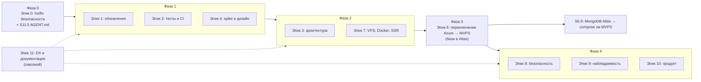

# SFL — бэклог пользовательских историй

> Основа: [Project_Architecture_Blueprint.md](../../Project_Architecture_Blueprint.md) и код репозитория на 2026-10-25.
> Цели: обновить зависимости, покрыть код тестами, исправить архитектуру, уйти с Azure на MVPS (Docker Compose) сразу с целевым монолитом Nest + Angular SSR, затем перенести MongoDB из Atlas на тот же сервер.

Этот файл — **единственное место, где хранится статус историй**. Каждая история лежит в отдельном файле в папке своего эпика.

## Как пользоваться

**Статус:** ✅ — выполнена (все ACs отмечены и приняты), ❌ — не выполнена, ⛔ — отменена (причина в разделе `## Заметки` файла истории).

**Поля таблицы:**
- **ID** — `S<эпик>.<номер>`, ссылка на файл истории. Файл называется так же: `S1.2.md`.
- **Приоритет**: P0 — немедленно, P1 — до миграции, P2 — миграция, P3 — после миграции.
- **Размер** — грубая оценка: S (≤1 дня), M (2–4 дня), L (неделя и больше).
- **Зависит от** — истории, которые должны быть ✅ до начала этой.

**Роли в DESC:** *пользователь* (игрок или болельщик), *администратор лиги* (ведёт матчи и игроков), *разработчик*.

### Для агента

Пока нет `AGENT.md` ([S11.5](E11-dx-docs/S11.5.md)), действуют эти правила:

1. **Выбор следующей истории.** Возьми историю со статусом ❌ (не ⛔) и наивысшим приоритетом, у которой все зависимости ✅. При равном приоритете — с меньшим номером эпика, затем с меньшим номером истории.
2. **Перед началом** прочитай файл истории целиком и файлы её зависимостей.
3. **Во время работы** отмечай выполненные ACs в файле истории (`- [ ]` → `- [x]`).
4. **Закрытие.** Когда все ACs отмечены, поменяй ❌ на ✅ в этой таблице. Делай это в том же коммите или PR, что и саму работу.
5. **Если AC невыполним или устарел** — не отмечай его. Добавь в конец файла истории раздел `## Заметки` с причиной и оставь статус ❌.
6. **Новая работа** оформляется новой историей: файл `S<эпик>.<следующий номер>.md` в папке эпика по образцу соседних и строка в таблице ниже.
7. **Не меняй ID** существующих историй и не удаляй их файлы, даже отменённые: на них ссылаются зависимости.

## Ключевые решения и допущения

1. **Безопасность прода идёт до обновлений.** Сейчас любой может без токена изменить или удалить матчи и игроков в проде (blueprint, п. 12.1). Это эпик 0, он небольшой и делается первым. Обновление зависимостей — сразу за ним. Прод на Azure до переключения получает только эпик 0: исправления в коде переедут на MVPS вместе с приложением, а в саму инфраструктуру Azure не вкладываемся.
2. **Целевая архитектура — монолит Nest + Angular SSR на VPS** (решение 2026-10-25, детали и отклонённые варианты в [S4.1](E04-migration-design/S4.1.md)). Один процесс Nest отдаёт `/rest/*` и рендерит Angular (с Material) через `AngularNodeAppEngine` на остальных маршрутах. Там же будут cron и websockets. Запуск — Docker Compose (`app → [mongodb]` за общим edge-прокси Caddy), деплой — GitHub Actions → GHCR → ssh. VPS рассчитан на несколько проектов: SFL изолирован в `/opt/sfl/` со своим compose-проектом, сетью и лимитами памяти, общий прокси живёт в `/opt/edge/` ([S7.9](E07-vps-hosting/S7.9.md)). Вариант «Angular на Netlify + Supabase без своего бэкенда» отклонён: Netlify не держит постоянные процессы, а сервер команде понятнее, чем RLS и SQL-функции. Поэтому эпик 5 отменён.
3. **NestJS остаётся**, поэтому его мажорное обновление ([S1.7](E01-dependency-upgrades/S1.7.md)) и улучшения архитектуры сервера (S3.3–S3.5) нужны и не будут выброшены.
4. **База остаётся MongoDB и переезжает в два шага.** Сначала прод на MVPS работает с текущим MongoDB Atlas, и при переключении ([S6.7](E06-data-migration/S6.7.md)) данные не трогаются, меняется только DNS. После отключения Azure дамп переносится в compose на MVPS ([S6.9](E06-data-migration/S6.9.md)). Истории про Postgres отменены (⛔). Расчёт статистики защищают golden-master тесты ([S2.2](E02-tests-ci/S2.2.md)).
5. **Пароли переводятся на современный хеш без участия пользователей.** Сейчас это SHA-512 без соли. При следующем входе Nest проверяет старый хеш и сохраняет новый (argon2id или bcrypt): стратегия в [S4.3](E04-migration-design/S4.3.md), реализация в [S8.7](E08-security-privacy/S8.7.md).
6. **Версии не зафиксированы в историях.** Целевые версии определяются в [S1.1](E01-dependency-upgrades/S1.1.md) на момент выполнения.

## Открытые вопросы к команде

1. Сколько пользователей реально входят в систему? Только администраторы или все игроки?
2. Настоящие ли email у пользователей? В `_backups` 219 из 220 адресов в домене `@sfl.lv`. Если ящиков нет, сброс пароля по почте не сработает.
3. Нужен ли `server/` (legacy Express) кому-то? Можно ли удалить?
4. Допустимо ли окно заморозки записи на время переезда (например, вечер между субботними играми)?
5. Есть ли у вас домен `sfl.com` (в dev-конфиге) или реальный прод-домен другой? Кто управляет его DNS?
6. ~~Бюджет на VPS~~ — сервер куплен за €8.47 в месяц ([S4.1](E04-migration-design/S4.1.md)). Открыто: какое внешнее хранилище брать для бэкапов ([S7.8](E07-vps-hosting/S7.8.md)).

## Дорожная карта

## Сводка эпиков

| Эпик | Папка | Историй |
|---|---|:-:|
| Эпик 0 — Hotfix безопасности текущего прода | [E00-security-hotfix/](E00-security-hotfix/) | 6 (1 отменена) |
| Эпик 1 — Обновление зависимостей и инструментов | [E01-dependency-upgrades/](E01-dependency-upgrades/) | 11 |
| Эпик 2 — Тесты и CI | [E02-tests-ci/](E02-tests-ci/) | 7 |
| Эпик 3 — Улучшение архитектуры | [E03-architecture/](E03-architecture/) | 10 |
| Эпик 4 — Spike и проектирование переезда | [E04-migration-design/](E04-migration-design/) | 4 (1 отменена) |
| Эпик 5 — Бэкенд на Supabase ⛔ | [E05-supabase-backend/](E05-supabase-backend/) | 9 (все отменены) |
| Эпик 6 — Миграция данных и переключение | [E06-data-migration/](E06-data-migration/) | 9 (5 отменено) |
| Эпик 7 — Хостинг на VPS | [E07-vps-hosting/](E07-vps-hosting/) | 9 |
| Эпик 8 — Безопасность и персональные данные | [E08-security-privacy/](E08-security-privacy/) | 7 |
| Эпик 9 — Наблюдаемость | [E09-observability/](E09-observability/) | 2 |
| Эпик 10 — Продуктовые фичи | [E10-product-features/](E10-product-features/) | 10 |
| Эпик 11 — DX, документация, чистота репозитория | [E11-dx-docs/](E11-dx-docs/) | 5 |

Всего историй: 89, из них отменено: 16.

---

## Эпик 0 — Hotfix безопасности текущего прода

| Статус | ID | История | Приоритет | Размер | Зависит от |
|:-:|---|---|:-:|:-:|---|
| ❌ | [S0.1](E00-security-hotfix/S0.1.md) | Закрыть изменяющие эндпоинты авторизацией | P0 | M | — |
| ❌ | [S0.2](E00-security-hotfix/S0.2.md) | Убрать пароль и учётные данные базы из логов | P0 | S | — |
| ❌ | [S0.3](E00-security-hotfix/S0.3.md) | Валидация должна отклонять неверные данные | P0 | S | — |
| ❌ | [S0.4](E00-security-hotfix/S0.4.md) | Пересчёт статистики через POST и с ожиданием результата | P0 | S | [S0.1](E00-security-hotfix/S0.1.md) |
| ❌ | [S0.5](E00-security-hotfix/S0.5.md) | Убрать хеши паролей и персональные данные из git | P0 | M | — |
| ⛔ | [S0.6](E00-security-hotfix/S0.6.md) | Вынести SSL-passphrase из кода | — | — | — |

## Эпик 1 — Обновление зависимостей и инструментов

| Статус | ID | История | Приоритет | Размер | Зависит от |
|:-:|---|---|:-:|:-:|---|
| ❌ | [S1.1](E01-dependency-upgrades/S1.1.md) | Инвентаризация зависимостей и целевые версии | P0 | S | — |
| ❌ | [S1.2](E01-dependency-upgrades/S1.2.md) | Единые версии Node.js и pnpm | P0 | S | [S1.1](E01-dependency-upgrades/S1.1.md) |
| ❌ | [S1.3](E01-dependency-upgrades/S1.3.md) | Обновить GitHub Actions | P0 | S | [S1.2](E01-dependency-upgrades/S1.2.md) |
| ❌ | [S1.4](E01-dependency-upgrades/S1.4.md) | Обновить Angular до актуального мажора | P1 | L | [S1.1](E01-dependency-upgrades/S1.1.md), [S2.1](E02-tests-ci/S2.1.md) |
| ❌ | [S1.5](E01-dependency-upgrades/S1.5.md) | Обновить клиентские библиотеки | P1 | M | [S1.4](E01-dependency-upgrades/S1.4.md) |
| ❌ | [S1.6](E01-dependency-upgrades/S1.6.md) | ESLint flat config и Prettier | P1 | M | [S1.4](E01-dependency-upgrades/S1.4.md) |
| ❌ | [S1.7](E01-dependency-upgrades/S1.7.md) | Обновить NestJS | P1 | M | [S1.1](E01-dependency-upgrades/S1.1.md), [S2.4](E02-tests-ci/S2.4.md) |
| ❌ | [S1.8](E01-dependency-upgrades/S1.8.md) | Перейти на valibot 1.x | P1 | M | [S0.3](E00-security-hotfix/S0.3.md) |
| ❌ | [S1.9](E01-dependency-upgrades/S1.9.md) | Обновить остальные серверные зависимости | P1 | S | [S1.1](E01-dependency-upgrades/S1.1.md) |
| ❌ | [S1.10](E01-dependency-upgrades/S1.10.md) | Удалить legacy-сервер `server/` | P1 | S | ответ на открытый вопрос 3 |
| ❌ | [S1.11](E01-dependency-upgrades/S1.11.md) | Автоматические обновления зависимостей | P2 | S | [S2.1](E02-tests-ci/S2.1.md) |

## Эпик 2 — Тесты и CI

| Статус | ID | История | Приоритет | Размер | Зависит от |
|:-:|---|---|:-:|:-:|---|
| ❌ | [S2.1](E02-tests-ci/S2.1.md) | CI для каждого PR | P1 | M | [S1.2](E01-dependency-upgrades/S1.2.md) |
| ❌ | [S2.2](E02-tests-ci/S2.2.md) | Golden-master тесты расчёта статистики | P1 | L | [S11.2](E11-dx-docs/S11.2.md) |
| ❌ | [S2.3](E02-tests-ci/S2.3.md) | Unit-тесты доменной логики | P1 | M | — |
| ❌ | [S2.4](E02-tests-ci/S2.4.md) | API-тесты прав доступа и CRUD | P1 | M | [S0.1](E00-security-hotfix/S0.1.md) |
| ❌ | [S2.5](E02-tests-ci/S2.5.md) | Перевести клиентские тесты на поддерживаемый раннер | P1 | M | [S1.4](E01-dependency-upgrades/S1.4.md) |
| ❌ | [S2.6](E02-tests-ci/S2.6.md) | E2E-тесты основных сценариев | P2 | M | [S2.1](E02-tests-ci/S2.1.md), [S7.2](E07-vps-hosting/S7.2.md) |
| ❌ | [S2.7](E02-tests-ci/S2.7.md) | Отчёт о покрытии и пороги | P2 | S | [S2.1](E02-tests-ci/S2.1.md) |

## Эпик 3 — Улучшение архитектуры

| Статус | ID | История | Приоритет | Размер | Зависит от |
|:-:|---|---|:-:|:-:|---|
| ❌ | [S3.1](E03-architecture/S3.1.md) | Вынести доменную логику в независимый модуль | P1 | L | [S2.2](E02-tests-ci/S2.2.md), [S2.3](E02-tests-ci/S2.3.md) |
| ❌ | [S3.2](E03-architecture/S3.2.md) | pnpm workspace и общие типы | P1 | M | [S1.2](E01-dependency-upgrades/S1.2.md) |
| ❌ | [S3.3](E03-architecture/S3.3.md) | Разорвать цикл games ↔ players | P2 | M | [S3.1](E03-architecture/S3.1.md) |
| ❌ | [S3.4](E03-architecture/S3.4.md) | Единый формат ответов API | P2 | M | [S2.4](E02-tests-ci/S2.4.md) |
| ❌ | [S3.5](E03-architecture/S3.5.md) | Атомарное сохранение матча и пересчёта | P2 | M | [S3.3](E03-architecture/S3.3.md) |
| ❌ | [S3.6](E03-architecture/S3.6.md) | Конфигурация окружений клиента | P1 | S | — |
| ❌ | [S3.7](E03-architecture/S3.7.md) | Привести состояние клиента к одному подходу | P2 | S | [S1.4](E01-dependency-upgrades/S1.4.md) |
| ❌ | [S3.8](E03-architecture/S3.8.md) | Границы слоёв клиента проверяются линтером | P2 | S | [S1.6](E01-dependency-upgrades/S1.6.md) |
| ❌ | [S3.9](E03-architecture/S3.9.md) | Вести ADR | P1 | S | — |
| ❌ | [S3.10](E03-architecture/S3.10.md) | Обработка ошибок и сессии на клиенте | P2 | M | [S3.6](E03-architecture/S3.6.md) |

## Эпик 4 — Spike и проектирование переезда

| Статус | ID | История | Приоритет | Размер | Зависит от |
|:-:|---|---|:-:|:-:|---|
| ❌ | [S4.1](E04-migration-design/S4.1.md) | Spike: монолит Nest + Angular SSR на VPS | P1 | M | — |
| ⛔ | [S4.2](E04-migration-design/S4.2.md) | Схема Postgres | — | — | — |
| ❌ | [S4.3](E04-migration-design/S4.3.md) | Стратегия миграции пользователей и паролей | P1 | S | [S4.1](E04-migration-design/S4.1.md), ответы на открытые вопросы 1 и 2 |
| ❌ | [S4.4](E04-migration-design/S4.4.md) | Аудит качества прод-данных | P1 | M | [S6.1](E06-data-migration/S6.1.md) |

## Эпик 5 — Бэкенд на Supabase ⛔

Эпик отменён 2026-10-25 решением [S4.1](E04-migration-design/S4.1.md). Файлы историй оставлены ради ссылок. В каждом в `## Заметки` указано, куда перешла полезная часть.

| Статус | ID | История | Приоритет | Размер | Зависит от |
|:-:|---|---|:-:|:-:|---|
| ⛔ | [S5.1](E05-supabase-backend/S5.1.md) | Проекты Supabase и миграции схемы в репозитории | — | — | — |
| ⛔ | [S5.2](E05-supabase-backend/S5.2.md) | Таблицы, enum-ы, ограничения | — | — | — |
| ⛔ | [S5.3](E05-supabase-backend/S5.3.md) | Аутентификация через Supabase Auth | — | — | — |
| ⛔ | [S5.4](E05-supabase-backend/S5.4.md) | RLS-политики и роли | — | — | — |
| ⛔ | [S5.5](E05-supabase-backend/S5.5.md) | Расчёт статистики в Supabase | — | — | — |
| ⛔ | [S5.6](E05-supabase-backend/S5.6.md) | Запросы для графиков | — | — | — |
| ⛔ | [S5.7](E05-supabase-backend/S5.7.md) | Файлы в Supabase Storage | — | — | — |
| ⛔ | [S5.8](E05-supabase-backend/S5.8.md) | Типы из схемы базы | — | — | — |
| ⛔ | [S5.9](E05-supabase-backend/S5.9.md) | Бэкапы Supabase | — | — | — |

## Эпик 6 — Миграция данных и переключение

Порядок: бэкап ([S6.1](E06-data-migration/S6.1.md)) → переключение трафика с Azure на MVPS при общей базе Atlas ([S6.7](E06-data-migration/S6.7.md)) → отключение Azure ([S6.8](E06-data-migration/S6.8.md)) → перенос базы из Atlas в compose ([S6.9](E06-data-migration/S6.9.md)).

| Статус | ID | История | Приоритет | Размер | Зависит от |
|:-:|---|---|:-:|:-:|---|
| ❌ | [S6.1](E06-data-migration/S6.1.md) | Полный бэкап прод MongoDB | P1 | S | — |
| ⛔ | [S6.2](E06-data-migration/S6.2.md) | ETL-скрипт переноса | — | — | — |
| ⛔ | [S6.3](E06-data-migration/S6.3.md) | Старые ссылки продолжают работать | — | — | — |
| ⛔ | [S6.4](E06-data-migration/S6.4.md) | Сверка данных после переноса | — | — | — |
| ⛔ | [S6.5](E06-data-migration/S6.5.md) | Перенос пользователей в Supabase Auth | — | — | — |
| ⛔ | [S6.6](E06-data-migration/S6.6.md) | Репетиции миграции на staging | — | — | — |
| ❌ | [S6.7](E06-data-migration/S6.7.md) | Переключение с Azure на MVPS и план отката | P2 | M | [S7.3](E07-vps-hosting/S7.3.md), [S7.5](E07-vps-hosting/S7.5.md), [S7.6](E07-vps-hosting/S7.6.md), [S7.8](E07-vps-hosting/S7.8.md), [S2.6](E02-tests-ci/S2.6.md) |
| ❌ | [S6.8](E06-data-migration/S6.8.md) | Отключение Azure | P3 | S | [S6.7](E06-data-migration/S6.7.md) |
| ❌ | [S6.9](E06-data-migration/S6.9.md) | Перенос MongoDB из Atlas в compose на MVPS | P3 | M | [S6.8](E06-data-migration/S6.8.md), [S7.8](E07-vps-hosting/S7.8.md) |

## Эпик 7 — Хостинг на VPS

| Статус | ID | История | Приоритет | Размер | Зависит от |
|:-:|---|---|:-:|:-:|---|
| ❌ | [S7.1](E07-vps-hosting/S7.1.md) | Один Docker-образ приложения | P2 | S | [S1.4](E01-dependency-upgrades/S1.4.md), [S3.6](E03-architecture/S3.6.md) |
| ❌ | [S7.2](E07-vps-hosting/S7.2.md) | Docker Compose для staging и prod | P2 | S | [S7.1](E07-vps-hosting/S7.1.md), [S4.1](E04-migration-design/S4.1.md) |
| ❌ | [S7.3](E07-vps-hosting/S7.3.md) | Домен и HTTPS через Caddy | P2 | S | [S7.2](E07-vps-hosting/S7.2.md), [S7.9](E07-vps-hosting/S7.9.md), ответ на открытый вопрос 5 |
| ❌ | [S7.4](E07-vps-hosting/S7.4.md) | Заголовки безопасности | P2 | S | [S7.3](E07-vps-hosting/S7.3.md) |
| ❌ | [S7.5](E07-vps-hosting/S7.5.md) | Nest рендерит Angular через SSR | P2 | M | [S1.4](E01-dependency-upgrades/S1.4.md), [S3.6](E03-architecture/S3.6.md) |
| ❌ | [S7.6](E07-vps-hosting/S7.6.md) | Деплой из GitHub Actions | P2 | S | [S7.2](E07-vps-hosting/S7.2.md), [S2.1](E02-tests-ci/S2.1.md) |
| ❌ | [S7.7](E07-vps-hosting/S7.7.md) | Базовая защита VPS | P1 | S | — |
| ❌ | [S7.8](E07-vps-hosting/S7.8.md) | Бэкапы базы во внешнее хранилище | P2 | S | [S7.2](E07-vps-hosting/S7.2.md), [S6.1](E06-data-migration/S6.1.md) |
| ❌ | [S7.9](E07-vps-hosting/S7.9.md) | Общий edge-прокси для нескольких проектов на VPS | P2 | S | [S7.7](E07-vps-hosting/S7.7.md) |

## Эпик 8 — Безопасность и персональные данные

| Статус | ID | История | Приоритет | Размер | Зависит от |
|:-:|---|---|:-:|:-:|---|
| ❌ | [S8.1](E08-security-privacy/S8.1.md) | Роли в интерфейсе | P2 | M | [S0.1](E00-security-hotfix/S0.1.md) |
| ❌ | [S8.2](E08-security-privacy/S8.2.md) | Защита входа от перебора | P2 | S | [S0.1](E00-security-hotfix/S0.1.md) |
| ❌ | [S8.3](E08-security-privacy/S8.3.md) | Проверка на секреты и уязвимости в CI | P2 | S | [S2.1](E02-tests-ci/S2.1.md) |
| ❌ | [S8.4](E08-security-privacy/S8.4.md) | Персональные данные и GDPR | P3 | M | [S0.1](E00-security-hotfix/S0.1.md) |
| ❌ | [S8.5](E08-security-privacy/S8.5.md) | Страница 404 и страницы ошибок | P3 | S | [S7.5](E07-vps-hosting/S7.5.md) |
| ❌ | [S8.6](E08-security-privacy/S8.6.md) | Безопасные ссылки и изображения на клиенте | P3 | S | [S7.4](E07-vps-hosting/S7.4.md) |
| ❌ | [S8.7](E08-security-privacy/S8.7.md) | Современное хеширование паролей | P1 | S | [S4.3](E04-migration-design/S4.3.md), [S2.4](E02-tests-ci/S2.4.md) |

## Эпик 9 — Наблюдаемость

| Статус | ID | История | Приоритет | Размер | Зависит от |
|:-:|---|---|:-:|:-:|---|
| ❌ | [S9.1](E09-observability/S9.1.md) | Отслеживание ошибок клиента | P3 | S | [S7.1](E07-vps-hosting/S7.1.md) |
| ❌ | [S9.2](E09-observability/S9.2.md) | Логи, доступность и алерты | P3 | S | [S7.6](E07-vps-hosting/S7.6.md) |

## Эпик 10 — Продуктовые фичи

Истории взяты из TODO в [README.md](../../README.md). Описания уточняются с владельцем продукта.

| Статус | ID | История | Приоритет | Размер | Зависит от |
|:-:|---|---|:-:|:-:|---|
| ❌ | [S10.1](E10-product-features/S10.1.md) | Пагинация матчей от новых к старым | P3 | S | [S3.4](E03-architecture/S3.4.md) |
| ❌ | [S10.2](E10-product-features/S10.2.md) | Удалённые матчи не отображаются | P3 | S | — |
| ❌ | [S10.3](E10-product-features/S10.3.md) | Дашборд с графиками | P3 | M | — |
| ❌ | [S10.4](E10-product-features/S10.4.md) | Графики на страницах матча и игрока | P3 | M | — |
| ❌ | [S10.5](E10-product-features/S10.5.md) | Рейтинг капитанов | P3 | M | [S3.1](E03-architecture/S3.1.md) |
| ❌ | [S10.6](E10-product-features/S10.6.md) | KPI игрока | P3 | M | [S3.1](E03-architecture/S3.1.md) |
| ❌ | [S10.7](E10-product-features/S10.7.md) | Экспорт в PDF | P3 | M | [S10.3](E10-product-features/S10.3.md) |
| ❌ | [S10.8](E10-product-features/S10.8.md) | Решить судьбу скрытых страниц | P3 | S | — |
| ❌ | [S10.9](E10-product-features/S10.9.md) | Плановые задачи на сервере | P3 | S | [S7.6](E07-vps-hosting/S7.6.md) |
| ❌ | [S10.10](E10-product-features/S10.10.md) | Обновления в реальном времени | P3 | M | [S7.3](E07-vps-hosting/S7.3.md), [S7.5](E07-vps-hosting/S7.5.md) |

## Эпик 11 — DX, документация, чистота репозитория

| Статус | ID | История | Приоритет | Размер | Зависит от |
|:-:|---|---|:-:|:-:|---|
| ❌ | [S11.1](E11-dx-docs/S11.1.md) | Локальный запуск за 15 минут | P1 | S | [S1.2](E01-dependency-upgrades/S1.2.md) (обновить после [S7.2](E07-vps-hosting/S7.2.md)) |
| ❌ | [S11.2](E11-dx-docs/S11.2.md) | Анонимизированные тестовые данные | P1 | M | [S6.1](E06-data-migration/S6.1.md) |
| ❌ | [S11.3](E11-dx-docs/S11.3.md) | Обновлять архитектурную документацию | P2 | S | [S6.7](E06-data-migration/S6.7.md) |
| ❌ | [S11.4](E11-dx-docs/S11.4.md) | Вычистить мусор из репозитория | P1 | M | [S2.1](E02-tests-ci/S2.1.md) |
| ❌ | [S11.5](E11-dx-docs/S11.5.md) | AGENT.md: инструкции для ИИ-агентов | P0 | S | — |
