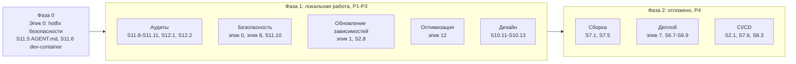

# SFL — бэклог пользовательских историй

> Основа: [Project_Architecture_Blueprint.md](../Project_Architecture_Blueprint.md) и код репозитория на 2026-10-25.
> Цели: обновить зависимости, покрыть код тестами, исправить архитектуру, уйти с Azure на MVPS (Docker Compose) сразу с целевым монолитом Nest + Angular SSR, затем перенести MongoDB из Atlas на тот же сервер.

Этот файл — **единственное место, где хранится статус историй**. Каждая история лежит в отдельном файле в папке своего эпика.

## Как пользоваться

**Статус:** ✅ — выполнена (все ACs отмечены и приняты), ❌ — не выполнена, ⛔ — отменена (причина в разделе `## Заметки` файла истории).

**Поля таблицы:**

- **ID** — `S<эпик>.<номер>`, ссылка на файл истории. Файл называется так же: `S1.2.md`.
- **Приоритет**: P0 — немедленно, P1 — локальный фокус сейчас, P2 — локально после P1, P3 — локально позже (продукт, оптимизация, отложенное), **P4 — отложено: сборка, деплой, CI/CD** (решение 2026-11-12, см. «Порядок работ»). Агент берёт P4 только по прямой просьбе владельца.
- **Размер** — грубая оценка: S (≤1 дня), M (2–4 дня), L (неделя и больше).
- **Зависит от** — истории, которые должны быть ✅ до начала этой.

**Роли в DESC:** _пользователь_ (игрок или болельщик), _администратор лиги_ (ведёт матчи и игроков), _разработчик_.

### Для агента

Те же правила изложены в [AGENT.md](../../AGENT.md) ([S11.5](E11-dx-docs/S11.5.md)):

1. **Выбор следующей истории.** Возьми историю со статусом ❌ (не ⛔) и наивысшим приоритетом, у которой все зависимости ✅. При равном приоритете — с меньшим номером эпика, затем с меньшим номером истории.
2. **Перед началом** прочитай файл истории целиком и файлы её зависимостей.
3. **Во время работы** отмечай выполненные ACs в файле истории (`- [ ]` → `- [x]`).
4. **Закрытие.** Когда все ACs отмечены, поменяй ❌ на ✅ в этой таблице. Делай это в том же коммите или PR, что и саму работу.
5. **Если AC невыполним или устарел** — не отмечай его. Добавь в конец файла истории раздел `## Заметки` с причиной и оставь статус ❌.
6. **Новая работа** оформляется новой историей: файл `S<эпик>.<следующий номер>.md` в папке эпика по образцу соседних и строка в таблице ниже.
7. **Не меняй ID** существующих историй и не удаляй их файлы, даже отменённые: на них ссылаются зависимости.

## Ключевые решения и допущения

1. **Безопасность прода идёт до обновлений.** Сейчас любой может без токена изменить или удалить матчи и игроков в проде (blueprint, п. 12.1). Это эпик 0, он небольшой и делается первым. Обновление зависимостей — сразу за ним. Прод на Azure до переключения получает только эпик 0: исправления в коде переедут на MVPS вместе с приложением, а в саму инфраструктуру Azure не вкладываемся.
2. **Целевая архитектура — монолит Nest на VPS: SPA и API на одном домене, SSR отложен** (решение 2026-10-25, уточнено 2026-11-15 по итогам [S4.1](E04-migration-design/S4.1.md), [ADR 0001](../adr/0001-monolith-nest-angular-ssr-on-vps.md)). Один процесс Nest отдаёт `/rest/*`, статику Angular-бандла отдаёт он же или Caddy, там же будут cron и websockets. Превью ссылок закрываются memmo и PWA, поэтому SSR ([S7.5](E07-vps-hosting/S7.5.md)) остаётся опцией: прототип работал, но не окупается. Запуск — Docker Compose (`app → [mongodb]` за общим edge-прокси Caddy), деплой — GitHub Actions → GHCR → ssh. VPS рассчитан на несколько проектов: SFL изолирован в `/opt/sfl/` со своим compose-проектом, сетью и лимитами памяти, общий прокси живёт в `/opt/edge/` ([S7.9](E07-vps-hosting/S7.9.md)). Вариант «Angular на Netlify + Supabase без своего бэкенда» отклонён: Netlify не держит постоянные процессы, а сервер команде понятнее, чем RLS и SQL-функции. Поэтому эпик 5 отменён.
3. **NestJS остаётся**, поэтому его мажорное обновление ([S1.7](E01-dependency-upgrades/S1.7.md)) и улучшения архитектуры сервера (S3.3–S3.5) нужны и не будут выброшены.
4. **База остаётся MongoDB и переезжает в два шага.** Сначала прод на MVPS работает с текущим MongoDB Atlas, и при переключении ([S6.7](E06-data-migration/S6.7.md)) данные не трогаются, меняется только DNS. После отключения Azure дамп переносится в compose на MVPS ([S6.9](E06-data-migration/S6.9.md)). Истории про Postgres отменены (⛔). Расчёт статистики защищают golden-master тесты ([S2.2](E02-tests-ci/S2.2.md)).
5. **Пароли переводятся на современный хеш без участия пользователей.** Сейчас это SHA-512 без соли. При следующем входе Nest проверяет старый хеш и сохраняет новый (argon2id или bcrypt): стратегия в [S4.3](E04-migration-design/S4.3.md), реализация в [S8.7](E08-security-privacy/S8.7.md).
6. **Версии не зафиксированы в историях.** Целевые версии определяются в [S1.1](E01-dependency-upgrades/S1.1.md) на момент выполнения.
7. **Сначала локальная работа, сборка, деплой и CI/CD в конец** (решение 2026-11-12). Всё, что относится к Docker-образу, SSR-сборке, хостингу на MVPS, переключению с Azure и CI/CD, получило приоритет P4 и сгруппировано в разделе «Порядок работ». Первыми идут аудиты, безопасность, обновление зависимостей, оптимизация и дизайн, и все они проверяются локально командой `pnpm check` ([S2.8](E02-tests-ci/S2.8.md)), а не CI.

8. **В репозитории нет GitHub workflow, прод на Azure не обновляется** (зафиксировано 2026-11-12). Каталога `.github/workflows/` нет, CI и автодеплой не работают. Предыдущий проект на Azure больше не обновляется и будет закрыт ([S6.8](E06-data-migration/S6.8.md)). Поэтому исправления эпика 0 на Azure не выкатываются, а ручные AC про логи и пользователей Azure ([S0.2](E00-security-hotfix/S0.2.md)) устарели. Истории про «обновить» существующие workflow ([S1.3](E01-dependency-upgrades/S1.3.md)) теперь надо понимать как «создать с нуля» в рамках CI/CD (P4).

## Открытые вопросы к команде

1. Сколько пользователей реально входят в систему? Только администраторы или все игроки?
2. Настоящие ли email у пользователей? В `_backups` 219 из 220 адресов в домене `@sfl.lv`. Если ящиков нет, сброс пароля по почте не сработает.
3. ~~Нужен ли `server/` (legacy Express) кому-то?~~ — не нужен, удалён ([S1.10](E01-dependency-upgrades/S1.10.md)).
4. Допустимо ли окно заморозки записи на время переезда (например, вечер между субботними играми)?
5. **TODO:** у сайта пока нет домена (2026-11-15, владелец). `sfl.com` — только dev-адрес из hosts. Нужно выбрать и купить домен до [S7.3](E07-vps-hosting/S7.3.md); пока он не выбран, адрес нигде не прописывается.
6. ~~Бюджет на VPS~~ — сервер куплен: MVPS, VPS BASIC, 2 vCPU, 4 GB RAM, 50 GB NVMe, €8.47 в месяц ([S4.1](E04-migration-design/S4.1.md), провайдер и тариф сверены 2026-11-15). Открыто: какое внешнее хранилище брать для бэкапов ([S7.8](E07-vps-hosting/S7.8.md)).

## Порядок работ

**Продуктовое направление (решение владельца 2026-11-15).** Главное — статистика: её расчёт, ввод и достоверность; всё остальное второстепенно. Админка идёт первой, чтобы наполнять контент: матчи 2011–2026 вносят вручную назначенные модераторы ([S10.49](E10-product-features/S10.49.md)). Транзакции MongoDB включаем ([S3.23](E03-architecture/S3.23.md), [ADR 0014](../adr/0014-mongodb-replica-set.md)). Порядок функций эпика 10 — по рейтингу [feature-priority.md](../design/feature-priority.md): уровень A (расчёт и наполнение) получил приоритет P2, остальное P3 в порядке рейтинга.

**Очерёдность (решение 2026-11-15).** Сначала приводим портал в порядок: обновление зависимостей, оптимизация, архитектура по лучшим практикам, безопасность и дизайн (группы 1–5 ниже). Только после этого собираем образ и настраиваем удалённый деплой по ssh на купленный сервер (группы «Сборка», «Деплой», «CI/CD», P4). Домена пока нет: он нужен к [S7.3](E07-vps-hosting/S7.3.md).

Работаем локально, в dev-контейнере. Каждая группа проверяется командой `pnpm check` ([S2.8](E02-tests-ci/S2.8.md)). Историю берём по правилам из «Для агента»: высший приоритет, зависимости ✅.

### Локально, сейчас (P0–P3)

| Группа                         | Истории                                                                                                                                                                                                                                                                                                                                                                                                                          | С чего начать           |
| ------------------------------ | -------------------------------------------------------------------------------------------------------------------------------------------------------------------------------------------------------------------------------------------------------------------------------------------------------------------------------------------------------------------------------------------------------------------------------- | ----------------------- |
| **1. Аудиты**                  | [S11.8](E11-dx-docs/S11.8.md) подбор skills → [S11.9](E11-dx-docs/S11.9.md) код, [S11.10](E11-dx-docs/S11.10.md) безопасность, [S12.1](E12-performance/S12.1.md) клиент, [S12.2](E12-performance/S12.2.md) MongoDB → [S11.11](E11-dx-docs/S11.11.md) доступность (после темы)                                                                                                                                                    | S11.8                   |
| **2. Безопасность**            | [S0.2](E00-security-hotfix/S0.2.md), [S0.3](E00-security-hotfix/S0.3.md), [S0.4](E00-security-hotfix/S0.4.md), [S0.5](E00-security-hotfix/S0.5.md), [S8.8](E08-security-privacy/S8.8.md), [S8.7](E08-security-privacy/S8.7.md), [S8.11](E08-security-privacy/S8.11.md), [S8.12](E08-security-privacy/S8.12.md), [S8.2](E08-security-privacy/S8.2.md), [S8.1](E08-security-privacy/S8.1.md), [S8.4](E08-security-privacy/S8.4.md) | S0.3, S0.4, S2.8 → S8.8 |
| **3. Обновление зависимостей** | [S2.8](E02-tests-ci/S2.8.md) → [S1.1](E01-dependency-upgrades/S1.1.md), [S1.2](E01-dependency-upgrades/S1.2.md), [S1.4](E01-dependency-upgrades/S1.4.md)–[S1.10](E01-dependency-upgrades/S1.10.md); страховка тестами: [S2.2](E02-tests-ci/S2.2.md)–[S2.5](E02-tests-ci/S2.5.md)                                                                                                                                                 | S2.8, S1.1              |
| **4. Оптимизация**             | [S12.1](E12-performance/S12.1.md), [S12.2](E12-performance/S12.2.md) → [S12.3](E12-performance/S12.3.md), [S12.4](E12-performance/S12.4.md)                                                                                                                                                                                                                                                                                      | S12.1, S12.2            |
| **5. Дизайн**                  | [S10.11](E10-product-features/S10.11.md) → [S10.12](E10-product-features/S10.12.md) → [S10.13](E10-product-features/S10.13.md) → [S11.11](E11-dx-docs/S11.11.md)                                                                                                                                                                                                                                                                 | S10.11                  |
| **Фоном**                      | Архитектура ([эпик 3](E03-architecture/)), DX ([S11.1](E11-dx-docs/S11.1.md), [S11.2](E11-dx-docs/S11.2.md), [S11.4](E11-dx-docs/S11.4.md), [S11.7](E11-dx-docs/S11.7.md)), продукт ([S10.1](E10-product-features/S10.1.md)–[S10.8](E10-product-features/S10.8.md))                                                                                                                                                              | по мере надобности      |

Тема Material ([S10.12](E10-product-features/S10.12.md)) зависит от обновления Angular ([S1.4](E01-dependency-upgrades/S1.4.md)), поэтому выбор направления ([S10.11](E10-product-features/S10.11.md)) можно начинать сразу, а применение темы после апдейта.

### Отложено в конец (P4): сборка, деплой, CI/CD

Возвращаемся, когда локальные группы закрыты или когда нужно выкатывать на MVPS.

| Группа     | Истории                                                                                                                                                                                                                                                                                                                                                                                                                                                                                                                                                                                                                                                                                                |
| ---------- | ------------------------------------------------------------------------------------------------------------------------------------------------------------------------------------------------------------------------------------------------------------------------------------------------------------------------------------------------------------------------------------------------------------------------------------------------------------------------------------------------------------------------------------------------------------------------------------------------------------------------------------------------------------------------------------------------------ |
| **Сборка** | [S7.1](E07-vps-hosting/S7.1.md) Docker-образ (SSR — [S7.5](E07-vps-hosting/S7.5.md), опция)                                                                                                                                                                                                                                                                                                                                                                                                                                                                                                                                                                                                            |
| **Деплой** | Хостинг и инфраструктура: [S7.2](E07-vps-hosting/S7.2.md), [S7.3](E07-vps-hosting/S7.3.md), [S7.4](E07-vps-hosting/S7.4.md), [S7.7](E07-vps-hosting/S7.7.md), [S7.8](E07-vps-hosting/S7.8.md), [S7.9](E07-vps-hosting/S7.9.md). Ротация учётных данных: [S0.7](E00-security-hotfix/S0.7.md). Переезд: [S6.7](E06-data-migration/S6.7.md), [S6.8](E06-data-migration/S6.8.md), [S6.9](E06-data-migration/S6.9.md). Зависят от деплоя: [S8.5](E08-security-privacy/S8.5.md), [S8.6](E08-security-privacy/S8.6.md), [S9.1](E09-observability/S9.1.md), [S9.2](E09-observability/S9.2.md), [S10.9](E10-product-features/S10.9.md), [S10.10](E10-product-features/S10.10.md), [S11.3](E11-dx-docs/S11.3.md) |
| **CI/CD**  | [S2.1](E02-tests-ci/S2.1.md) CI на PR, [S2.6](E02-tests-ci/S2.6.md) E2E, [S2.7](E02-tests-ci/S2.7.md) покрытие, [S1.11](E01-dependency-upgrades/S1.11.md) авто-обновления, [S8.3](E08-security-privacy/S8.3.md) сканеры в CI, [S7.6](E07-vps-hosting/S7.6.md) деплой из Actions                                                                                                                                                                                                                                                                                                                                                                                                                        |

Локальные замены отложенным проверкам: вместо CI — [S2.8](E02-tests-ci/S2.8.md), вместо сканеров в CI — [S8.8](E08-security-privacy/S8.8.md).

## Дорожная карта

## Сводка эпиков

| Эпик                                            | Папка                                                |     Историй      |
| ----------------------------------------------- | ---------------------------------------------------- | :--------------: |
| Эпик 0 — Hotfix безопасности текущего прода     | [E00-security-hotfix/](E00-security-hotfix/)         |  7 (1 отменена)  |
| Эпик 1 — Обновление зависимостей и инструментов | [E01-dependency-upgrades/](E01-dependency-upgrades/) | 13 (2 отменены)  |
| Эпик 2 — Тесты и CI                             | [E02-tests-ci/](E02-tests-ci/)                       |        8         |
| Эпик 3 — Улучшение архитектуры                  | [E03-architecture/](E03-architecture/)               |        32        |
| Эпик 4 — Spike и проектирование переезда        | [E04-migration-design/](E04-migration-design/)       |  4 (1 отменена)  |
| Эпик 5 — Бэкенд на Supabase ⛔                  | [E05-supabase-backend/](E05-supabase-backend/)       | 9 (все отменены) |
| Эпик 6 — Миграция данных и переключение         | [E06-data-migration/](E06-data-migration/)           | 10 (5 отменено)  |
| Эпик 7 — Хостинг на VPS                         | [E07-vps-hosting/](E07-vps-hosting/)                 |        9         |
| Эпик 8 — Безопасность и персональные данные     | [E08-security-privacy/](E08-security-privacy/)       |        13        |
| Эпик 9 — Наблюдаемость                          | [E09-observability/](E09-observability/)             |        2         |
| Эпик 10 — Продуктовые фичи                      | [E10-product-features/](E10-product-features/)       |        79        |
| Эпик 11 — DX, документация, чистота репозитория | [E11-dx-docs/](E11-dx-docs/)                         |        12        |
| Эпик 12 — Производительность и оптимизация      | [E12-performance/](E12-performance/)                 |        4         |

Всего историй: 202, из них отменено: 18.

---

## Эпик 0 — Hotfix безопасности текущего прода

| Статус | ID                                  | История                                                 | Приоритет | Размер | Зависит от                          |
| :----: | ----------------------------------- | ------------------------------------------------------- | :-------: | :----: | ----------------------------------- |
|   ✅   | [S0.1](E00-security-hotfix/S0.1.md) | Закрыть изменяющие эндпоинты авторизацией               |    P0     |   M    | —                                   |
|   ✅   | [S0.2](E00-security-hotfix/S0.2.md) | Убрать пароль и учётные данные базы из логов            |    P0     |   S    | —                                   |
|   ✅   | [S0.3](E00-security-hotfix/S0.3.md) | Валидация должна отклонять неверные данные              |    P0     |   S    | —                                   |
|   ✅   | [S0.4](E00-security-hotfix/S0.4.md) | Пересчёт статистики через POST и с ожиданием результата |    P0     |   S    | [S0.1](E00-security-hotfix/S0.1.md) |
|   ✅   | [S0.5](E00-security-hotfix/S0.5.md) | Убрать хеши паролей и персональные данные из git        |    P0     |   M    | —                                   |
|   ⛔   | [S0.6](E00-security-hotfix/S0.6.md) | Вынести SSL-passphrase из кода                          |     —     |   —    | —                                   |
|   ❌   | [S0.7](E00-security-hotfix/S0.7.md) | Ротация учётных данных после публикации в git           |    P4     |   S    | —                                   |

## Эпик 1 — Обновление зависимостей и инструментов

| Статус | ID                                        | История                                            | Приоритет | Размер | Зависит от                                                                                          |
| :----: | ----------------------------------------- | -------------------------------------------------- | :-------: | :----: | --------------------------------------------------------------------------------------------------- |
|   ✅   | [S1.1](E01-dependency-upgrades/S1.1.md)   | Инвентаризация зависимостей и целевые версии       |    P0     |   S    | —                                                                                                   |
|   ✅   | [S1.2](E01-dependency-upgrades/S1.2.md)   | Единые версии Node.js и pnpm                       |    P0     |   S    | [S1.1](E01-dependency-upgrades/S1.1.md)                                                             |
|   ⛔   | [S1.3](E01-dependency-upgrades/S1.3.md)   | Обновить GitHub Actions                            |     —     |   —    | —                                                                                                   |
|   ✅   | [S1.4](E01-dependency-upgrades/S1.4.md)   | Обновить Angular до актуального мажора             |    P1     |   L    | [S1.1](E01-dependency-upgrades/S1.1.md), [S2.8](E02-tests-ci/S2.8.md)                               |
|   ✅   | [S1.5](E01-dependency-upgrades/S1.5.md)   | Обновить клиентские библиотеки                     |    P1     |   M    | [S1.4](E01-dependency-upgrades/S1.4.md)                                                             |
|   ✅   | [S1.6](E01-dependency-upgrades/S1.6.md)   | ESLint flat config и Prettier                      |    P1     |   M    | [S1.4](E01-dependency-upgrades/S1.4.md)                                                             |
|   ✅   | [S1.7](E01-dependency-upgrades/S1.7.md)   | Обновить NestJS                                    |    P1     |   M    | [S1.1](E01-dependency-upgrades/S1.1.md), [S2.4](E02-tests-ci/S2.4.md)                               |
|   ✅   | [S1.13](E01-dependency-upgrades/S1.13.md) | Дообновить серверные зависимости после NestJS 12   |    P1     |   S    | [S1.7](E01-dependency-upgrades/S1.7.md)                                                             |
|   ⛔   | [S1.8](E01-dependency-upgrades/S1.8.md)   | Перейти на valibot 1.x                             |    P1     |   M    | [S0.3](E00-security-hotfix/S0.3.md)                                                                 |
|   ✅   | [S1.9](E01-dependency-upgrades/S1.9.md)   | Обновить остальные серверные зависимости           |    P1     |   S    | [S1.1](E01-dependency-upgrades/S1.1.md)                                                             |
|   ✅   | [S1.10](E01-dependency-upgrades/S1.10.md) | Удалить legacy-сервер `server/`                    |    P1     |   S    | ответ на открытый вопрос 3                                                                          |
|   ❌   | [S1.11](E01-dependency-upgrades/S1.11.md) | Автоматические обновления зависимостей             |    P4     |   S    | [S2.1](E02-tests-ci/S2.1.md)                                                                        |
|   ✅   | [S1.12](E01-dependency-upgrades/S1.12.md) | Заменить valibot на zod, общие схемы клиент/сервер |    P1     |   M    | [S0.3](E00-security-hotfix/S0.3.md), [S2.8](E02-tests-ci/S2.8.md), [S3.2](E03-architecture/S3.2.md) |

## Эпик 2 — Тесты и CI

| Статус | ID                           | История                                         | Приоритет | Размер | Зависит от                                                            |
| :----: | ---------------------------- | ----------------------------------------------- | :-------: | :----: | --------------------------------------------------------------------- |
|   ❌   | [S2.1](E02-tests-ci/S2.1.md) | CI для каждого PR                               |    P4     |   M    | [S1.2](E01-dependency-upgrades/S1.2.md), [S2.8](E02-tests-ci/S2.8.md) |
|   ✅   | [S2.2](E02-tests-ci/S2.2.md) | Golden-master тесты расчёта статистики          |    P1     |   L    | [S11.2](E11-dx-docs/S11.2.md)                                         |
|   ✅   | [S2.3](E02-tests-ci/S2.3.md) | Unit-тесты доменной логики                      |    P1     |   M    | —                                                                     |
|   ✅   | [S2.4](E02-tests-ci/S2.4.md) | API-тесты прав доступа и CRUD                   |    P1     |   M    | [S0.1](E00-security-hotfix/S0.1.md)                                   |
|   ✅   | [S2.5](E02-tests-ci/S2.5.md) | Клиентские тесты на Vitest вместо Karma/Jasmine |    P1     |   M    | [S1.4](E01-dependency-upgrades/S1.4.md)                               |
|   ❌   | [S2.6](E02-tests-ci/S2.6.md) | E2E-тесты основных сценариев                    |    P4     |   M    | [S2.1](E02-tests-ci/S2.1.md), [S7.2](E07-vps-hosting/S7.2.md)         |
|   ❌   | [S2.7](E02-tests-ci/S2.7.md) | Отчёт о покрытии и пороги                       |    P4     |   S    | [S2.1](E02-tests-ci/S2.1.md)                                          |
|   ✅   | [S2.8](E02-tests-ci/S2.8.md) | Единая локальная команда проверки               |    P1     |   S    | [S1.2](E01-dependency-upgrades/S1.2.md)                               |

## Эпик 3 — Улучшение архитектуры

| Статус | ID                                 | История                                                                  | Приоритет | Размер | Зависит от                                                                  |
| :----: | ---------------------------------- | ------------------------------------------------------------------------ | :-------: | :----: | --------------------------------------------------------------------------- |
|   ✅   | [S3.1](E03-architecture/S3.1.md)   | Вынести доменную логику в независимый модуль                             |    P1     |   L    | [S2.2](E02-tests-ci/S2.2.md), [S2.3](E02-tests-ci/S2.3.md)                  |
|   ✅   | [S3.2](E03-architecture/S3.2.md)   | pnpm workspace и общие схемы и типы                                      |    P1     |   M    | [S1.2](E01-dependency-upgrades/S1.2.md)                                     |
|   ✅   | [S3.3](E03-architecture/S3.3.md)   | Разорвать цикл games ↔ players                                           |    P2     |   M    | [S3.1](E03-architecture/S3.1.md)                                            |
|   ✅   | [S3.4](E03-architecture/S3.4.md)   | Единый формат ответов API                                                |    P2     |   M    | [S2.4](E02-tests-ci/S2.4.md)                                                |
|   ✅   | [S3.5](E03-architecture/S3.5.md)   | Атомарное сохранение матча и пересчёта                                   |    P2     |   M    | [S3.3](E03-architecture/S3.3.md)                                            |
|   ✅   | [S3.6](E03-architecture/S3.6.md)   | Конфигурация окружений клиента                                           |    P1     |   S    | —                                                                           |
|   ✅   | [S3.7](E03-architecture/S3.7.md)   | Привести состояние клиента к одному подходу                              |    P2     |   S    | [S1.4](E01-dependency-upgrades/S1.4.md)                                     |
|   ✅   | [S3.8](E03-architecture/S3.8.md)   | Границы слоёв клиента проверяются линтером                               |    P2     |   S    | [S1.6](E01-dependency-upgrades/S1.6.md)                                     |
|   ✅   | [S3.9](E03-architecture/S3.9.md)   | Вести ADR                                                                |    P1     |   S    | —                                                                           |
|   ✅   | [S3.10](E03-architecture/S3.10.md) | Обработка ошибок и сессии на клиенте                                     |    P2     |   M    | [S3.6](E03-architecture/S3.6.md)                                            |
|   ✅   | [S3.11](E03-architecture/S3.11.md) | Исправить расчёт метаданных матча и игрока                               |    P1     |   L    | [S2.3](E02-tests-ci/S2.3.md)                                                |
|   ✅   | [S3.12](E03-architecture/S3.12.md) | Корректные HTTP-ошибки и обработка исключений                            |    P1     |   M    | [S2.4](E02-tests-ci/S2.4.md)                                                |
|   ✅   | [S3.13](E03-architecture/S3.13.md) | Клиент: позиция и один капитан обязательны для публикации матча          |    P1     |   S    | [S3.11](E03-architecture/S3.11.md)                                          |
|   ✅   | [S3.14](E03-architecture/S3.14.md) | Пересчёт метаданных всех матчей после исправления расчёта                |    P2     |   S    | [S3.11](E03-architecture/S3.11.md)                                          |
|   ❌   | [S3.15](E03-architecture/S3.15.md) | Перейти на zoneless и убрать zone.js                                     |    P2     |   M    | [S1.4](E01-dependency-upgrades/S1.4.md), [S3.9](E03-architecture/S3.9.md)   |
|   ❌   | [S3.16](E03-architecture/S3.16.md) | Signal forms: пилот на одной форме                                       |    P2     |   M    | [S1.4](E01-dependency-upgrades/S1.4.md), [S3.9](E03-architecture/S3.9.md)   |
|   ✅   | [S3.17](E03-architecture/S3.17.md) | Привести структуру клиента к FSD                                         |    P2     |   L    | [S3.6](E03-architecture/S3.6.md)                                            |
|   ❌   | [S3.18](E03-architecture/S3.18.md) | Реактивность клиента по практикам Angular 22                             |    P2     |   M    | [S1.4](E01-dependency-upgrades/S1.4.md)                                     |
|   ✅   | [S3.19](E03-architecture/S3.19.md) | Типы и контракты API из одной схемы: zod → TypeScript и OpenAPI          |    P2     |   L    | [S1.12](E01-dependency-upgrades/S1.12.md), [S3.4](E03-architecture/S3.4.md) |
|   ✅   | [S3.20](E03-architecture/S3.20.md) | Убрать вызовы клиента к несуществующим маршрутам API                     |    P1     |   S    | —                                                                           |
|   ✅   | [S3.21](E03-architecture/S3.21.md) | Выровнять REST API: лексика, семантика, топология                        |    P2     |   M    | [S3.20](E03-architecture/S3.20.md)                                          |
|   ✅   | [S3.22](E03-architecture/S3.22.md) | Исправить ошибки и гонки в сторах клиента                                |    P1     |   M    | [S1.4](E01-dependency-upgrades/S1.4.md), [S2.5](E02-tests-ci/S2.5.md)       |
|   ✅   | [S3.23](E03-architecture/S3.23.md) | MongoDB как replica set (транзакции)                                     |    P2     |   M    | —                                                                           |
|   ✅   | [S3.24](E03-architecture/S3.24.md) | Исправить правила и сторы формы матча по ревью                           |    P1     |   M    | [S3.22](E03-architecture/S3.22.md)                                          |
|   ✅   | [S3.25](E03-architecture/S3.25.md) | Стор капитанов без дубля списка игроков                                  |    P2     |   S    | [S3.22](E03-architecture/S3.22.md), [S3.7](E03-architecture/S3.7.md)        |
|   ✅   | [S3.26](E03-architecture/S3.26.md) | Steiger как проверка структуры FSD                                       |    P3     |   S    | [S3.8](E03-architecture/S3.8.md)                                            |
|   ✅   | [S3.27](E03-architecture/S3.27.md) | Инкрементальный пересчёт статистики и проверочный полный пересчёт        |    P2     |   L    | [S3.1](E03-architecture/S3.1.md), [S3.5](E03-architecture/S3.5.md)          |
|   ✅   | [S3.28](E03-architecture/S3.28.md) | Повторяющиеся блоки клиента: вынести в `entities/*/ui` и `shared/ui/kit` |    P2     |   M    | [S3.17](E03-architecture/S3.17.md), [S3.8](E03-architecture/S3.8.md)        |
|   ✅   | [S3.29](E03-architecture/S3.29.md) | Шапка игрока и карточка рейтинга: вынести в общие блоки клиента          |    P3     |   M    | [S3.28](E03-architecture/S3.28.md)                                          |
|   ❌   | [S3.30](E03-architecture/S3.30.md) | Малые формы клиента на signal forms                                      |    P3     |   M    | [S3.16](E03-architecture/S3.16.md)                                          |
|   ❌   | [S3.31](E03-architecture/S3.31.md) | Форма матча на signal forms                                              |    P3     |   L    | [S3.16](E03-architecture/S3.16.md), [S3.13](E03-architecture/S3.13.md)      |
|   ❌   | [S3.32](E03-architecture/S3.32.md) | Контракт API: перенос схем, ответы успеха и имена типов                  |    P3     |   L    | [S3.19](E03-architecture/S3.19.md)                                          |

## Эпик 4 — Spike и проектирование переезда

| Статус | ID                                   | История                                    | Приоритет | Размер | Зависит от                                                             |
| :----: | ------------------------------------ | ------------------------------------------ | :-------: | :----: | ---------------------------------------------------------------------- |
|   ✅   | [S4.1](E04-migration-design/S4.1.md) | Spike: монолит Nest на VPS, проверка SSR   |    P1     |   M    | —                                                                      |
|   ⛔   | [S4.2](E04-migration-design/S4.2.md) | Схема Postgres                             |     —     |   —    | —                                                                      |
|   ❌   | [S4.3](E04-migration-design/S4.3.md) | Стратегия миграции пользователей и паролей |    P1     |   S    | [S4.1](E04-migration-design/S4.1.md), ответы на открытые вопросы 1 и 2 |
|   ❌   | [S4.4](E04-migration-design/S4.4.md) | Аудит качества прод-данных                 |    P1     |   M    | [S6.1](E06-data-migration/S6.1.md)                                     |

## Эпик 5 — Бэкенд на Supabase ⛔

Эпик отменён 2026-10-25 решением [S4.1](E04-migration-design/S4.1.md). Файлы историй оставлены ради ссылок. В каждом в `## Заметки` указано, куда перешла полезная часть.

| Статус | ID                                   | История                                         | Приоритет | Размер | Зависит от |
| :----: | ------------------------------------ | ----------------------------------------------- | :-------: | :----: | ---------- |
|   ⛔   | [S5.1](E05-supabase-backend/S5.1.md) | Проекты Supabase и миграции схемы в репозитории |     —     |   —    | —          |
|   ⛔   | [S5.2](E05-supabase-backend/S5.2.md) | Таблицы, enum-ы, ограничения                    |     —     |   —    | —          |
|   ⛔   | [S5.3](E05-supabase-backend/S5.3.md) | Аутентификация через Supabase Auth              |     —     |   —    | —          |
|   ⛔   | [S5.4](E05-supabase-backend/S5.4.md) | RLS-политики и роли                             |     —     |   —    | —          |
|   ⛔   | [S5.5](E05-supabase-backend/S5.5.md) | Расчёт статистики в Supabase                    |     —     |   —    | —          |
|   ⛔   | [S5.6](E05-supabase-backend/S5.6.md) | Запросы для графиков                            |     —     |   —    | —          |
|   ⛔   | [S5.7](E05-supabase-backend/S5.7.md) | Файлы в Supabase Storage                        |     —     |   —    | —          |
|   ⛔   | [S5.8](E05-supabase-backend/S5.8.md) | Типы из схемы базы                              |     —     |   —    | —          |
|   ⛔   | [S5.9](E05-supabase-backend/S5.9.md) | Бэкапы Supabase                                 |     —     |   —    | —          |

## Эпик 6 — Миграция данных и переключение

Порядок: бэкап ([S6.1](E06-data-migration/S6.1.md)) → переключение трафика с Azure на MVPS при общей базе Atlas ([S6.7](E06-data-migration/S6.7.md)) → отключение Azure ([S6.8](E06-data-migration/S6.8.md)) → перенос базы из Atlas в compose ([S6.9](E06-data-migration/S6.9.md)).

| Статус | ID                                   | История                                    | Приоритет | Размер | Зависит от                                                                                                                                                       |
| :----: | ------------------------------------ | ------------------------------------------ | :-------: | :----: | ---------------------------------------------------------------------------------------------------------------------------------------------------------------- |
|   ❌   | [S6.1](E06-data-migration/S6.1.md)   | Полный бэкап прод MongoDB                  |    P1     |   S    | —                                                                                                                                                                |
|   ⛔   | [S6.2](E06-data-migration/S6.2.md)   | ETL-скрипт переноса                        |     —     |   —    | —                                                                                                                                                                |
|   ⛔   | [S6.3](E06-data-migration/S6.3.md)   | Старые ссылки продолжают работать          |     —     |   —    | —                                                                                                                                                                |
|   ⛔   | [S6.4](E06-data-migration/S6.4.md)   | Сверка данных после переноса               |     —     |   —    | —                                                                                                                                                                |
|   ⛔   | [S6.5](E06-data-migration/S6.5.md)   | Перенос пользователей в Supabase Auth      |     —     |   —    | —                                                                                                                                                                |
|   ⛔   | [S6.6](E06-data-migration/S6.6.md)   | Репетиции миграции на staging              |     —     |   —    | —                                                                                                                                                                |
|   ❌   | [S6.7](E06-data-migration/S6.7.md)   | Переключение с Azure на MVPS и план отката |    P4     |   M    | [S7.3](E07-vps-hosting/S7.3.md), [S7.5](E07-vps-hosting/S7.5.md), [S7.6](E07-vps-hosting/S7.6.md), [S7.8](E07-vps-hosting/S7.8.md), [S2.6](E02-tests-ci/S2.6.md) |
|   ❌   | [S6.8](E06-data-migration/S6.8.md)   | Отключение Azure                           |    P4     |   S    | [S6.7](E06-data-migration/S6.7.md)                                                                                                                               |
|   ❌   | [S6.9](E06-data-migration/S6.9.md)   | Перенос MongoDB из Atlas в compose на MVPS |    P4     |   M    | [S6.8](E06-data-migration/S6.8.md), [S7.8](E07-vps-hosting/S7.8.md)                                                                                              |
|   ❌   | [S6.10](E06-data-migration/S6.10.md) | Автоматический дамп базы по расписанию     |    P2     |   S    | [S6.1](E06-data-migration/S6.1.md)                                                                                                                               |

## Эпик 7 — Хостинг на VPS

| Статус | ID                              | История                                          | Приоритет | Размер | Зависит от                                                                                   |
| :----: | ------------------------------- | ------------------------------------------------ | :-------: | :----: | -------------------------------------------------------------------------------------------- |
|   ❌   | [S7.1](E07-vps-hosting/S7.1.md) | Один Docker-образ приложения                     |    P4     |   S    | [S1.4](E01-dependency-upgrades/S1.4.md), [S3.6](E03-architecture/S3.6.md)                    |
|   ❌   | [S7.2](E07-vps-hosting/S7.2.md) | Docker Compose для staging и prod                |    P4     |   S    | [S7.1](E07-vps-hosting/S7.1.md), [S4.1](E04-migration-design/S4.1.md)                        |
|   ❌   | [S7.3](E07-vps-hosting/S7.3.md) | Домен и HTTPS через Caddy                        |    P4     |   S    | [S7.2](E07-vps-hosting/S7.2.md), [S7.9](E07-vps-hosting/S7.9.md), ответ на открытый вопрос 5 |
|   ❌   | [S7.4](E07-vps-hosting/S7.4.md) | Заголовки безопасности                           |    P4     |   S    | [S7.3](E07-vps-hosting/S7.3.md)                                                              |
|   ❌   | [S7.5](E07-vps-hosting/S7.5.md) | Nest рендерит Angular через SSR                  |    P4     |   M    | [S1.4](E01-dependency-upgrades/S1.4.md), [S3.6](E03-architecture/S3.6.md)                    |
|   ❌   | [S7.6](E07-vps-hosting/S7.6.md) | Деплой из GitHub Actions                         |    P4     |   S    | [S7.2](E07-vps-hosting/S7.2.md), [S2.1](E02-tests-ci/S2.1.md)                                |
|   ❌   | [S7.7](E07-vps-hosting/S7.7.md) | Базовая защита VPS                               |    P4     |   S    | —                                                                                            |
|   ❌   | [S7.8](E07-vps-hosting/S7.8.md) | Бэкапы базы во внешнее хранилище                 |    P4     |   S    | [S7.2](E07-vps-hosting/S7.2.md), [S6.1](E06-data-migration/S6.1.md)                          |
|   ❌   | [S7.9](E07-vps-hosting/S7.9.md) | Общий edge-прокси для нескольких проектов на VPS |    P4     |   S    | [S7.7](E07-vps-hosting/S7.7.md)                                                              |

## Эпик 8 — Безопасность и персональные данные

| Статус | ID                                     | История                                                        | Приоритет | Размер | Зависит от                                                                                                         |
| :----: | -------------------------------------- | -------------------------------------------------------------- | :-------: | :----: | ------------------------------------------------------------------------------------------------------------------ |
|   ✅   | [S8.1](E08-security-privacy/S8.1.md)   | Роли в интерфейсе                                              |    P2     |   M    | [S0.1](E00-security-hotfix/S0.1.md)                                                                                |
|   ❌   | [S8.2](E08-security-privacy/S8.2.md)   | Защита входа от перебора                                       |    P2     |   S    | [S0.1](E00-security-hotfix/S0.1.md)                                                                                |
|   ❌   | [S8.3](E08-security-privacy/S8.3.md)   | Проверка на секреты и уязвимости в CI                          |    P4     |   S    | [S2.1](E02-tests-ci/S2.1.md), [S8.8](E08-security-privacy/S8.8.md)                                                 |
|   ❌   | [S8.4](E08-security-privacy/S8.4.md)   | Персональные данные и GDPR                                     |    P3     |   M    | [S0.1](E00-security-hotfix/S0.1.md)                                                                                |
|   ❌   | [S8.5](E08-security-privacy/S8.5.md)   | Страница 404 и страницы ошибок                                 |    P4     |   S    | [S7.5](E07-vps-hosting/S7.5.md)                                                                                    |
|   ❌   | [S8.6](E08-security-privacy/S8.6.md)   | Безопасные ссылки и изображения на клиенте                     |    P4     |   S    | [S7.4](E07-vps-hosting/S7.4.md)                                                                                    |
|   ❌   | [S8.7](E08-security-privacy/S8.7.md)   | Современное хеширование паролей                                |    P1     |   S    | [S4.3](E04-migration-design/S4.3.md), [S2.4](E02-tests-ci/S2.4.md)                                                 |
|   ✅   | [S8.8](E08-security-privacy/S8.8.md)   | Локальная проверка секретов и уязвимых зависимостей            |    P1     |   S    | [S2.8](E02-tests-ci/S2.8.md)                                                                                       |
|   ✅   | [S8.9](E08-security-privacy/S8.9.md)   | Авторизация по ролям на сервере и защита от mass assignment    |    P1     |   M    | [S2.4](E02-tests-ci/S2.4.md)                                                                                       |
|   ✅   | [S8.10](E08-security-privacy/S8.10.md) | Не отдавать email и персональные данные публичными эндпоинтами |    P1     |   S    | [S0.1](E00-security-hotfix/S0.1.md)                                                                                |
|   ✅   | [S8.11](E08-security-privacy/S8.11.md) | Защита от перебора, заголовки и Swagger                        |    P2     |   S    | [S2.4](E02-tests-ci/S2.4.md)                                                                                       |
|   ✅   | [S8.12](E08-security-privacy/S8.12.md) | Сессии и токены: отзыв, Secure, секреты JWT                    |    P2     |   M    | [S2.4](E02-tests-ci/S2.4.md), [S8.9](E08-security-privacy/S8.9.md)                                                 |
|   ❌   | [S8.13](E08-security-privacy/S8.13.md) | Вход через Google и привязка аккаунта к игроку                 |    P3     |   L    | [S8.9](E08-security-privacy/S8.9.md), [S8.10](E08-security-privacy/S8.10.md), [S4.3](E04-migration-design/S4.3.md) |

## Эпик 9 — Наблюдаемость

| Статус | ID                                | История                     | Приоритет | Размер | Зависит от                      |
| :----: | --------------------------------- | --------------------------- | :-------: | :----: | ------------------------------- |
|   ❌   | [S9.1](E09-observability/S9.1.md) | Отслеживание ошибок клиента |    P4     |   S    | [S7.1](E07-vps-hosting/S7.1.md) |
|   ❌   | [S9.2](E09-observability/S9.2.md) | Логи, доступность и алерты  |    P4     |   S    | [S7.6](E07-vps-hosting/S7.6.md) |

## Эпик 10 — Продуктовые фичи

Истории взяты из TODO в [README.md](../../README.md). Описания уточняются с владельцем продукта.

| Статус | ID                                       | История                                                                                 | Приоритет | Размер | Зависит от                                                                                                                                                                                                       |
| :----: | ---------------------------------------- | --------------------------------------------------------------------------------------- | :-------: | :----: | ---------------------------------------------------------------------------------------------------------------------------------------------------------------------------------------------------------------- |
|   ❌   | [S10.1](E10-product-features/S10.1.md)   | Пагинация матчей от новых к старым                                                      |    P3     |   S    | [S3.4](E03-architecture/S3.4.md)                                                                                                                                                                                 |
|   ❌   | [S10.2](E10-product-features/S10.2.md)   | Удалённые матчи не отображаются                                                         |    P3     |   S    | —                                                                                                                                                                                                                |
|   ❌   | [S10.3](E10-product-features/S10.3.md)   | Дашборд с графиками                                                                     |    P3     |   M    | —                                                                                                                                                                                                                |
|   ❌   | [S10.4](E10-product-features/S10.4.md)   | Графики на страницах матча и игрока                                                     |    P3     |   M    | —                                                                                                                                                                                                                |
|   ❌   | [S10.5](E10-product-features/S10.5.md)   | Рейтинг капитанов                                                                       |    P3     |   M    | [S3.1](E03-architecture/S3.1.md)                                                                                                                                                                                 |
|   ❌   | [S10.6](E10-product-features/S10.6.md)   | KPI игрока                                                                              |    P3     |   M    | [S3.1](E03-architecture/S3.1.md)                                                                                                                                                                                 |
|   ❌   | [S10.7](E10-product-features/S10.7.md)   | Экспорт в PDF                                                                           |    P3     |   M    | [S10.3](E10-product-features/S10.3.md)                                                                                                                                                                           |
|   ❌   | [S10.8](E10-product-features/S10.8.md)   | Решить судьбу скрытых страниц                                                           |    P3     |   S    | —                                                                                                                                                                                                                |
|   ❌   | [S10.9](E10-product-features/S10.9.md)   | Плановые задачи на сервере                                                              |    P4     |   S    | [S7.6](E07-vps-hosting/S7.6.md)                                                                                                                                                                                  |
|   ❌   | [S10.10](E10-product-features/S10.10.md) | Обновления в реальном времени                                                           |    P4     |   M    | [S7.3](E07-vps-hosting/S7.3.md), [S7.5](E07-vps-hosting/S7.5.md)                                                                                                                                                 |
|   ✅   | [S10.11](E10-product-features/S10.11.md) | Выбор дизайн-направления через design skills                                            |    P2     |   S    | [S11.8](E11-dx-docs/S11.8.md)                                                                                                                                                                                    |
|   ✅   | [S10.12](E10-product-features/S10.12.md) | Тема Angular Material: палитра, типографика, тёмная тема                                |    P2     |   M    | [S10.11](E10-product-features/S10.11.md), [S1.4](E01-dependency-upgrades/S1.4.md)                                                                                                                                |
|   ❌   | [S10.13](E10-product-features/S10.13.md) | Применить тему ко всем страницам                                                        |    P3     |   M    | [S10.12](E10-product-features/S10.12.md)                                                                                                                                                                         |
|   ❌   | [S10.14](E10-product-features/S10.14.md) | Состояния интерфейса и движение                                                         |    P2     |   M    | [S3.10](E03-architecture/S3.10.md)                                                                                                                                                                               |
|   ❌   | [S10.15](E10-product-features/S10.15.md) | Мультиязычность интерфейса (английский, латышский, русский)                             |    P3     |   M    | [S10.14](E10-product-features/S10.14.md), [S10.12](E10-product-features/S10.12.md)                                                                                                                               |
|   ❌   | [S10.16](E10-product-features/S10.16.md) | Понятность форм, навигации и текстов                                                    |    P2     |   M    | [S10.14](E10-product-features/S10.14.md)                                                                                                                                                                         |
|   ❌   | [S10.17](E10-product-features/S10.17.md) | Личный кабинет игрока                                                                   |    P3     |   L    | [S10.12](E10-product-features/S10.12.md), [S8.1](E08-security-privacy/S8.1.md)                                                                                                                                   |
|   ✅   | [S10.18](E10-product-features/S10.18.md) | Статус матча «Пропущен»                                                                 |    P2     |   S    | —                                                                                                                                                                                                                |
|   ✅   | [S10.19](E10-product-features/S10.19.md) | Админка: отдельная часть клиента и фото                                                 |    P2     |   L    | [S3.17](E03-architecture/S3.17.md), [S10.12](E10-product-features/S10.12.md), [S8.1](E08-security-privacy/S8.1.md)                                                                                               |
|   ❌   | [S10.20](E10-product-features/S10.20.md) | Страница матча: превью, события, MVP, составы и карта расстановки                       |    P3     |   L    | [S10.12](E10-product-features/S10.12.md), [S3.22](E03-architecture/S3.22.md)                                                                                                                                     |
|   ❌   | [S10.21](E10-product-features/S10.21.md) | Дашборд администратора                                                                  |    P2     |   L    | [S10.19](E10-product-features/S10.19.md), [S10.22](E10-product-features/S10.22.md), [S8.1](E08-security-privacy/S8.1.md)                                                                                         |
|   ❌   | [S10.22](E10-product-features/S10.22.md) | Комментарии к матчам и модерация                                                        |    P3     |   M    | [S8.4](E08-security-privacy/S8.4.md), [S8.9](E08-security-privacy/S8.9.md)                                                                                                                                       |
|   ❌   | [S10.23](E10-product-features/S10.23.md) | Фото и видео                                                                            |    P2     |   M    | [S10.19](E10-product-features/S10.19.md), [S10.12](E10-product-features/S10.12.md)                                                                                                                               |
|   ❌   | [S10.24](E10-product-features/S10.24.md) | История лиги                                                                            |    P3     |   S    | [S10.12](E10-product-features/S10.12.md)                                                                                                                                                                         |
|   ❌   | [S10.25](E10-product-features/S10.25.md) | Предсказание шанса на победу                                                            |    P2     |   M    | [S3.1](E03-architecture/S3.1.md), [S10.21](E10-product-features/S10.21.md)                                                                                                                                       |
|   ❌   | [S10.26](E10-product-features/S10.26.md) | Единый набор значков (спрайт)                                                           |    P3     |   S    | [S10.12](E10-product-features/S10.12.md)                                                                                                                                                                         |
|   ❌   | [S10.27](E10-product-features/S10.27.md) | Порядок голов и передач                                                                 |    P2     |   M    | [S2.2](E02-tests-ci/S2.2.md), [S10.21](E10-product-features/S10.21.md)                                                                                                                                           |
|   ❌   | [S10.28](E10-product-features/S10.28.md) | Значки позиций и выбор позиции                                                          |    P3     |   S    | [S10.26](E10-product-features/S10.26.md)                                                                                                                                                                         |
|   ❌   | [S10.29](E10-product-features/S10.29.md) | Страница игрока: статистика и вкладка «Капитан»                                         |    P3     |   L    | [S10.12](E10-product-features/S10.12.md), [S10.26](E10-product-features/S10.26.md), [S3.22](E03-architecture/S3.22.md)                                                                                           |
|   ❌   | [S10.30](E10-product-features/S10.30.md) | Список игроков и рейтинг                                                                |    P3     |   M    | [S10.12](E10-product-features/S10.12.md), [S10.28](E10-product-features/S10.28.md)                                                                                                                               |
|   ❌   | [S10.31](E10-product-features/S10.31.md) | Страница капитанов: карточки, таблица и матрица встреч                                  |    P3     |   M    | [S10.5](E10-product-features/S10.5.md), [S10.12](E10-product-features/S10.12.md)                                                                                                                                 |
|   ❌   | [S10.32](E10-product-features/S10.32.md) | Админка: игроки, капитаны, расписание и трансферы                                       |    P2     |   L    | [S10.21](E10-product-features/S10.21.md), [S10.18](E10-product-features/S10.18.md), [S10.28](E10-product-features/S10.28.md)                                                                                     |
|   ❌   | [S10.33](E10-product-features/S10.33.md) | Профиль аккаунта: привязка к игроку, язык, тема, данные                                 |    P3     |   M    | [S8.13](E08-security-privacy/S8.13.md), [S10.12](E10-product-features/S10.12.md)                                                                                                                                 |
|   ❌   | [S10.34](E10-product-features/S10.34.md) | Сезоны и зал славы                                                                      |    P3     |   M    | [S10.12](E10-product-features/S10.12.md), [S10.24](E10-product-features/S10.24.md)                                                                                                                               |
|   ❌   | [S10.35](E10-product-features/S10.35.md) | Публикация матча по двум подтверждениям и отзыв                                         |    P2     |   L    | [S10.21](E10-product-features/S10.21.md), [S8.9](E08-security-privacy/S8.9.md), [S10.18](E10-product-features/S10.18.md)                                                                                         |
|   ❌   | [S10.36](E10-product-features/S10.36.md) | Свод правил (кодекс)                                                                    |    P3     |   M    | [S10.12](E10-product-features/S10.12.md)                                                                                                                                                                         |
|   ❌   | [S10.37](E10-product-features/S10.37.md) | Голосование игроков, предложения и жалобы (в том числе анонимные)                       |    P3     |   L    | [S10.36](E10-product-features/S10.36.md), [S8.13](E08-security-privacy/S8.13.md), [S8.11](E08-security-privacy/S8.11.md)                                                                                         |
|   ❌   | [S10.38](E10-product-features/S10.38.md) | Страница «Как начисляются очки»: старая и новая система                                 |    P3     |   M    | [S10.12](E10-product-features/S10.12.md), [S10.28](E10-product-features/S10.28.md)                                                                                                                               |
|   ❌   | [S10.39](E10-product-features/S10.39.md) | Описание матча (история)                                                                |    P2     |   S    | [S10.20](E10-product-features/S10.20.md), [S10.35](E10-product-features/S10.35.md)                                                                                                                               |
|   ❌   | [S10.40](E10-product-features/S10.40.md) | Обработка матчей: очередь с 1980 года и плавающая заметка                               |    P2     |   L    | [S10.21](E10-product-features/S10.21.md), [S10.35](E10-product-features/S10.35.md), [S10.18](E10-product-features/S10.18.md)                                                                                     |
|   ❌   | [S10.41](E10-product-features/S10.41.md) | Теги на фотографиях и фильтр по игрокам                                                 |    P3     |   M    | [S10.23](E10-product-features/S10.23.md)                                                                                                                                                                         |
|   ❌   | [S10.42](E10-product-features/S10.42.md) | Футер и переключатель темы                                                              |    P3     |   S    | [S10.12](E10-product-features/S10.12.md), [S10.33](E10-product-features/S10.33.md)                                                                                                                               |
|   ❌   | [S10.43](E10-product-features/S10.43.md) | Главная страница: свежее, горячее, память, дни рождения                                 |    P3     |   L    | [S10.12](E10-product-features/S10.12.md), [S10.29](E10-product-features/S10.29.md), [S10.30](E10-product-features/S10.30.md), [S10.37](E10-product-features/S10.37.md), [S10.44](E10-product-features/S10.44.md) |
|   ❌   | [S10.44](E10-product-features/S10.44.md) | Календарь и дни рождения                                                                |    P2     |   M    | [S10.18](E10-product-features/S10.18.md), [S10.33](E10-product-features/S10.33.md)                                                                                                                               |
|   ❌   | [S10.45](E10-product-features/S10.45.md) | Сравнение систем счёта и выбор системы в шапке                                          |    P3     |   M    | [S10.38](E10-product-features/S10.38.md), [S10.30](E10-product-features/S10.30.md), [S10.33](E10-product-features/S10.33.md)                                                                                     |
|   ❌   | [S10.46](E10-product-features/S10.46.md) | Добавление игрока и профиль новичка                                                     |    P2     |   M    | [S10.32](E10-product-features/S10.32.md), [S10.33](E10-product-features/S10.33.md), [S10.28](E10-product-features/S10.28.md)                                                                                     |
|   ❌   | [S10.47](E10-product-features/S10.47.md) | Compare side by side: игроки, капитаны, статистика                                      |    P3     |   L    | [S10.29](E10-product-features/S10.29.md), [S10.30](E10-product-features/S10.30.md), [S10.31](E10-product-features/S10.31.md), [S10.45](E10-product-features/S10.45.md)                                           |
|   ❌   | [S10.48](E10-product-features/S10.48.md) | Ссылка на один день для подключения аккаунта игрока                                     |    P2     |   L    | [S8.13](E08-security-privacy/S8.13.md), [S10.32](E10-product-features/S10.32.md), [S10.33](E10-product-features/S10.33.md), [S10.46](E10-product-features/S10.46.md)                                             |
|   ❌   | [S10.49](E10-product-features/S10.49.md) | Ввод матчей 2011–2026 назначенными модераторами                                         |    P2     |   L    | [S10.35](E10-product-features/S10.35.md), [S10.40](E10-product-features/S10.40.md), [S10.46](E10-product-features/S10.46.md)                                                                                     |
|   ❌   | [S10.50](E10-product-features/S10.50.md) | Светлая тема (делается последней)                                                       |    P3     |   M    | [S10.13](E10-product-features/S10.13.md), [S10.49](E10-product-features/S10.49.md)                                                                                                                               |
|   ❌   | [S10.51](E10-product-features/S10.51.md) | Release notes и информация о релизе в футере                                            |    P3     |   S    | [S10.12](E10-product-features/S10.12.md)                                                                                                                                                                         |
|   ❌   | [S10.52](E10-product-features/S10.52.md) | Админка «Releases»: заметки релиза как на GitHub                                        |    P3     |   M    | [S10.51](E10-product-features/S10.51.md), [S10.35](E10-product-features/S10.35.md)                                                                                                                               |
|   ❌   | [S10.53](E10-product-features/S10.53.md) | Админка фото и видео: загрузка, очередь без тегов, массовые теги                        |    P3     |   M    | [S10.23](E10-product-features/S10.23.md), [S10.41](E10-product-features/S10.41.md), [S10.19](E10-product-features/S10.19.md)                                                                                     |
|   ❌   | [S10.54](E10-product-features/S10.54.md) | Один матч редактирует один администратор и сохранение черновика                         |    P2     |   L    | [S3.23](E03-architecture/S3.23.md), [S10.21](E10-product-features/S10.21.md)                                                                                                                                     |
|   ❌   | [S10.55](E10-product-features/S10.55.md) | Доработать макеты «Табло» по аудиту                                                     |    P2     |   M    | [S10.11](E10-product-features/S10.11.md)                                                                                                                                                                         |
|   ❌   | [S10.56](E10-product-features/S10.56.md) | Данные главной: следующая игра, «Горячее сейчас», «В этот день», игрок в фокусе         |    P2     |   M    | [S10.43](E10-product-features/S10.43.md), [S10.18](E10-product-features/S10.18.md)                                                                                                                               |
|   ❌   | [S10.57](E10-product-features/S10.57.md) | Рейтинг игроков: сдвиг места и история таблицы                                          |    P3     |   M    | [S10.29](E10-product-features/S10.29.md)                                                                                                                                                                         |
|   ❌   | [S10.58](E10-product-features/S10.58.md) | Страница игрока: радар, суббота-календарь, позиции и цвета команд, соперники и союзники |    P2     |   L    | [S10.29](E10-product-features/S10.29.md), [S10.4](E10-product-features/S10.4.md)                                                                                                                                 |
|   ❌   | [S10.59](E10-product-features/S10.59.md) | Сравнение игроков и капитанов: совместные игры                                          |    P3     |   M    | [S10.58](E10-product-features/S10.58.md)                                                                                                                                                                         |
|   ❌   | [S10.60](E10-product-features/S10.60.md) | Капитаны: матрица встреч, личные встречи, первые выборы, капитаны дня                   |    P2     |   L    | [S10.5](E10-product-features/S10.5.md)                                                                                                                                                                           |
|   ❌   | [S10.61](E10-product-features/S10.61.md) | Страница матча: порядок голов и карта расстановки                                       |    P3     |   M    | [S10.27](E10-product-features/S10.27.md), [S10.38](E10-product-features/S10.38.md)                                                                                                                               |
|   ❌   | [S10.62](E10-product-features/S10.62.md) | Календарь, дни рождения, ссылка iCal                                                    |    P3     |   M    | [S10.44](E10-product-features/S10.44.md)                                                                                                                                                                         |
|   ❌   | [S10.63](E10-product-features/S10.63.md) | Правила, голосования и предложения на данных                                            |    P2     |   L    | [S10.36](E10-product-features/S10.36.md), [S10.37](E10-product-features/S10.37.md), [S10.35](E10-product-features/S10.35.md)                                                                                     |
|   ❌   | [S10.64](E10-product-features/S10.64.md) | Фото, видео и комментарии на данных                                                     |    P3     |   L    | [S10.22](E10-product-features/S10.22.md), [S10.23](E10-product-features/S10.23.md)                                                                                                                               |
|   ❌   | [S10.65](E10-product-features/S10.65.md) | История лиги и зал славы                                                                |    P4     |   M    | [S10.24](E10-product-features/S10.24.md)                                                                                                                                                                         |
|   ❌   | [S10.66](E10-product-features/S10.66.md) | Профиль, подключение аккаунтов и новый игрок                                            |    P2     |   L    | [S8.13](E08-security-privacy/S8.13.md), [S10.17](E10-product-features/S10.17.md)                                                                                                                                 |
|   ❌   | [S10.67](E10-product-features/S10.67.md) | Мастер матча и подтверждения на данных                                                  |    P2     |   L    | [S10.54](E10-product-features/S10.54.md), [S10.35](E10-product-features/S10.35.md), [S10.27](E10-product-features/S10.27.md)                                                                                     |
|   ❌   | [S10.68](E10-product-features/S10.68.md) | Обработка старых матчей, расписание, пропуски и трансферы                               |    P3     |   L    | [S10.40](E10-product-features/S10.40.md), [S10.18](E10-product-features/S10.18.md)                                                                                                                               |
|   ❌   | [S10.69](E10-product-features/S10.69.md) | Релизы: публичные заметки и админка                                                     |    P3     |   M    | [S10.51](E10-product-features/S10.51.md)                                                                                                                                                                         |
|   ❌   | [S10.70](E10-product-features/S10.70.md) | Страницы очков и сравнения систем из `@sfl/domain`                                      |    P3     |   S    | [S10.38](E10-product-features/S10.38.md), [S10.45](E10-product-features/S10.45.md)                                                                                                                               |
|   ❌   | [S10.71](E10-product-features/S10.71.md) | Шапка: поиск, переключатель темы и тексты подвала                                       |    P3     |   S    | [S10.50](E10-product-features/S10.50.md)                                                                                                                                                                         |
|   ❌   | [S10.72](E10-product-features/S10.72.md) | Убрать Angular Material из рабочих форм и тема Highcharts                               |    P3     |   L    | [S10.12](E10-product-features/S10.12.md)                                                                                                                                                                         |
|   ❌   | [S10.73](E10-product-features/S10.73.md) | Сверка клиента с досками «Табло»                                                        |    P2     |   M    | [S10.12](E10-product-features/S10.12.md)                                                                                                                                                                         |
|   ❌   | [S10.74](E10-product-features/S10.74.md) | Перекидное табло: цифры счёта и отсчёта на плашках                                      |    P3     |   S    | [S10.12](E10-product-features/S10.12.md)                                                                                                                                                                         |
|   ❌   | [S10.75](E10-product-features/S10.75.md) | Лента суббот: сезон одной полосой                                                       |    P2     |   S    | [S10.1](E10-product-features/S10.1.md)                                                                                                                                                                           |
|   ❌   | [S10.76](E10-product-features/S10.76.md) | Главный блок главной: капитан против капитана в стиле UFC                               |    P2     |   M    | [S10.60](E10-product-features/S10.60.md), [S10.56](E10-product-features/S10.56.md), [S3.28](E03-architecture/S3.28.md)                                                                                           |
|   ❌   | [S10.77](E10-product-features/S10.77.md) | Афиша боя: два капитана лицом к лицу, статистика и шансы на победу                      |    P2     |   L    | [S10.76](E10-product-features/S10.76.md), [S10.25](E10-product-features/S10.25.md)                                                                                                                               |
|   ❌   | [S10.78](E10-product-features/S10.78.md) | OpenGraph: превью ссылок на сайт в мессенджерах и соцсетях                              |    P3     |   M    | [S10.77](E10-product-features/S10.77.md), [S8.10](E08-security-privacy/S8.10.md)                                                                                                                                 |
|   ❌   | [S10.79](E10-product-features/S10.79.md) | Идея: MVP матча по голосу зрительских симпатий (не в работе)                            |    P4     |   —    | —                                                                                                                                                                                                                |

## Эпик 11 — DX, документация, чистота репозитория

| Статус | ID                              | История                                    | Приоритет | Размер | Зависит от                                                                        |
| :----: | ------------------------------- | ------------------------------------------ | :-------: | :----: | --------------------------------------------------------------------------------- |
|   ✅   | [S11.1](E11-dx-docs/S11.1.md)   | Локальный запуск за 15 минут               |    P1     |   S    | [S1.2](E01-dependency-upgrades/S1.2.md) (позже обновить после S7.2, она отложена) |
|   ✅   | [S11.2](E11-dx-docs/S11.2.md)   | Анонимизированные тестовые данные          |    P1     |   M    | [S6.1](E06-data-migration/S6.1.md)                                                |
|   ❌   | [S11.3](E11-dx-docs/S11.3.md)   | Обновлять архитектурную документацию       |    P4     |   S    | [S6.7](E06-data-migration/S6.7.md)                                                |
|   ✅   | [S11.4](E11-dx-docs/S11.4.md)   | Вычистить мусор из репозитория             |    P1     |   M    | [S2.8](E02-tests-ci/S2.8.md)                                                      |
|   ✅   | [S11.5](E11-dx-docs/S11.5.md)   | AGENT.md: инструкции для ИИ-агентов        |    P0     |   S    | —                                                                                 |
|   ✅   | [S11.6](E11-dx-docs/S11.6.md)   | Dev-container для локальной разработки     |    P0     |   M    | —                                                                                 |
|   ✅   | [S11.7](E11-dx-docs/S11.7.md)   | Pre-commit хуки: husky и lint-staged       |    P1     |   S    | [S1.6](E01-dependency-upgrades/S1.6.md)                                           |
|   ✅   | [S11.8](E11-dx-docs/S11.8.md)   | Подбор agent skills для аудитов и дизайна  |    P1     |   S    | [S11.5](E11-dx-docs/S11.5.md)                                                     |
|   ✅   | [S11.9](E11-dx-docs/S11.9.md)   | Аудит кода: качество и ошибки              |    P1     |   M    | [S11.8](E11-dx-docs/S11.8.md)                                                     |
|   ✅   | [S11.10](E11-dx-docs/S11.10.md) | Аудит безопасности                         |    P1     |   M    | [S11.8](E11-dx-docs/S11.8.md)                                                     |
|   ❌   | [S11.11](E11-dx-docs/S11.11.md) | Аудит доступности и UI на Angular Material |    P2     |   M    | [S11.8](E11-dx-docs/S11.8.md), [S10.12](E10-product-features/S10.12.md)           |
|   ✅   | [S11.12](E11-dx-docs/S11.12.md) | EditorConfig и единые окончания строк      |    P1     |   S    | —                                                                                 |

## Эпик 12 — Производительность и оптимизация

| Статус | ID                                | История                                         | Приоритет | Размер | Зависит от                                                                 |
| :----: | --------------------------------- | ----------------------------------------------- | :-------: | :----: | -------------------------------------------------------------------------- |
|   ✅   | [S12.1](E12-performance/S12.1.md) | Аудит производительности клиента                |    P2     |   M    | [S11.8](E11-dx-docs/S11.8.md)                                              |
|   ✅   | [S12.2](E12-performance/S12.2.md) | Аудит запросов и индексов MongoDB               |    P2     |   M    | [S11.8](E11-dx-docs/S11.8.md)                                              |
|   ❌   | [S12.3](E12-performance/S12.3.md) | Оптимизация клиента по результатам аудита       |    P3     |   M    | [S12.1](E12-performance/S12.1.md), [S1.4](E01-dependency-upgrades/S1.4.md) |
|   ✅   | [S12.4](E12-performance/S12.4.md) | Индексы и запросы MongoDB по результатам аудита |    P3     |   M    | [S12.2](E12-performance/S12.2.md)                                          |
